# 第一章 极限与连续

## 目录

- [第01节 函数及其性质](#第01节-函数及其性质)
- [第02节 函数的性质、复合函数与反函数](#第02节-函数的性质、复合函数与反函数)
- [第03节 数列极限](#第03节-数列极限)
- [第04节 单调有界原理](#第04节-单调有界原理)
- [第05节 重要极限和幂指转换](#第05节-重要极限和幂指转换)
- [第06节 等价无穷小、四则运算和洛必达法则](#第06节-等价无穷小、四则运算和洛必达法则)
- [第07节 泰勒公式、左右极限和极限反问题](#第07节-泰勒公式、左右极限和极限反问题)
- [第08节 连续和间断](#第08节-连续和间断)

---

# 第01节 函数及其性质

## 1. 数集

（1）实数集 $\mathbb{R}=(-\infty,+\infty)$
（2）正实数 $\mathbb{R}^{+}=(0,+\infty)$
（3）有理数 $\mathbb{Q}$： $\mathbb{Q} \subset \mathbb{R}$
（4）整数 $\mathbb{Z}=\{-n,\cdots,-1,0,1,\cdots,n,\cdots\}$
（5）正整数 $\mathbb{N}^{+}=\{1,2,\cdots,n,\cdots\}$
（6）自然数 $\mathbb{N}=\{0,1,2,\cdots,n,\cdots\}$

## 2. 区间

（1）$(a,b)=\{x\mid a<x<b\}$
（2）$[a,b]=\{x\mid a\le x\le b\}$
（3）$(a,b]=\{x\mid a<x\le b\}$
（4）$[a,b)=\{x\mid a\le x<b\}$ —— **有界区间**
（5）$(a,+\infty)=\{x\mid a<x<+\infty\}$
（6）$[a,+\infty)=\{x\mid a\le x<+\infty\}$
（7）$(-\infty,b)=\{x\mid -\infty<x<b\}$
（8）$(-\infty,b]=\{x\mid -\infty<x\le b\}$
（9）$(-\infty,+\infty)=\{x\mid -\infty<x<+\infty\}$ —— **实数域**

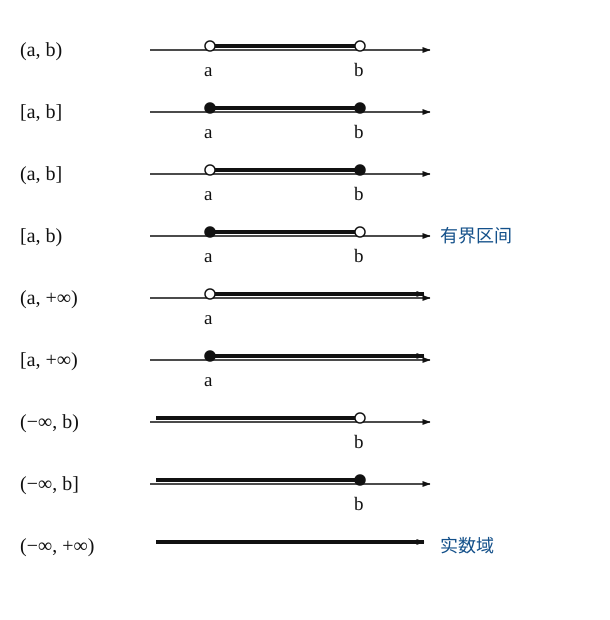

## 3. 邻域

（1）$x_0$ 的邻域 $U_\delta(x_0)=\{x\mid |x-x_0|<\delta\}$，其中 $\delta>0$
（2）$x_0$ 的去心邻域 $\mathring{U}_\delta(x_0)=\{x\mid 0<|x-x_0|<\delta\}$，其中 $\delta>0$

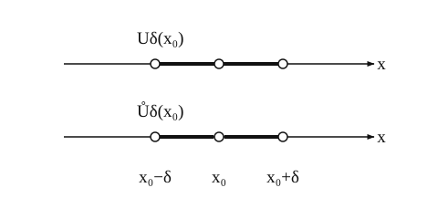

## 4. 映射

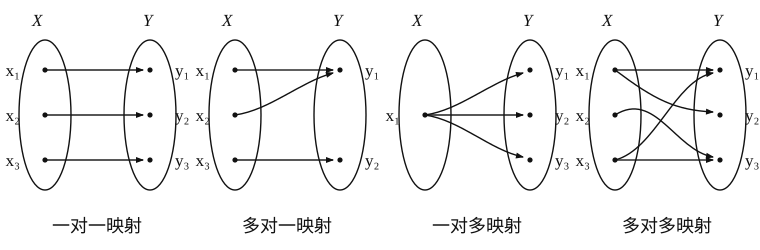

## 5. 函数

（1）$x\in D$，称 $D$ 为**定义域**
（2）$y\in R_f$，称 $R_f$ 为**值域**
（3）映射 $f$（一对一、多对一）称为函数

### （1）函数表达式

### 📝 例题 1
**【题目】**：判断函数 $f(x)=x$，$g(x)=x^2$ 是否是相同的函数关系。

**【解析】**：

（1）$f(x)=x$，$D_f=(-\infty,+\infty)$，$R_f=(-\infty,+\infty)$

（2）$g(x)=x^2$，$D_g=(-\infty,+\infty)$，$R_g=[0,+\infty)$

$\because f(x)\ne g(x)$，映射法则不同，

$\therefore f(x)$ 与 $g(x)$ 不是相同函数。

### 📝 例题 2
**【题目】**：判断 $f(x)=x^2$，$g(t)=t^2$ 是否是相同函数关系。

**【解析】**：

（1）$f(x)=x^2$，$D_f=(-\infty,+\infty)$，$a\mapsto a^2$

（2）$g(t)=t^2$，$D_g=(-\infty,+\infty)$，$a\mapsto a^2$

$\therefore f$ 与 $g$ 是相同的函数关系。

### 📝 例题 3
**【题目】**：下列选项中，函数 $f(x)$ 和 $g(x)$ 是相同的是（　　）

- (A) $f(x)=x^0$，$g(x)=1$
- (B) $f(x)=\lg x^2$，$g(x)=2\lg x$
- (C) $f(x)=x$，$g(x)=\sqrt{x^2}$
- (D) $f(x)=\sin x$，$g(x)=\cos\left(\dfrac{\pi}{2}-x\right)$

**【解析】**：

- (A) $f(x)=x^0=1\ (x\ne 0)$；$g(x)=1\ (x\in\mathbb{R})$，**定义域不同**。
- (B) $f(x)=\lg x^2=2\lg x\ (x\ne 0)$；$g(x)=2\lg x\ (x>0)$，**定义域不同**。

> ⚠️ **[智能体A注]**：原笔记处写作 $\lg x^2=2\lg x$，严格应为 $\lg x^2=2\lg|x|\ (x\ne 0)$；此处不影响"定义域不同"的结论。

- (C) $f(x)=x\ (x\in\mathbb{R})$；$g(x)=\sqrt{x^2}=|x|\ (x\in\mathbb{R})$，**对应法则不同**。
- (D) $g(x)=\cos\left(\dfrac{\pi}{2}-x\right)=\sin x=f(x)$。✓

故答案为 **D**。

## 6. 基本初等函数

### （1）常值函数 $y=C$

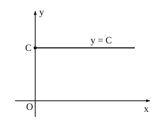

### （2）幂函数 $y=x^\mu$（$x>0,\ \mu\ne 0$）

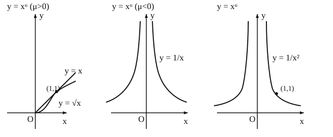

### （3）指数函数 $y=a^x$（$a>0,\ a\ne 1$）

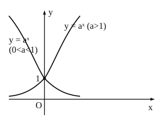

运算性质：

$$a^m\cdot a^n=a^{m+n}$$

$$(a^m)^n=a^{mn}$$

$$\frac{a^m}{a^n}=a^{m-n}$$

$$(ab)^n=a^n b^n$$

### （4）对数函数 $y=\log_a x$（$a>0,\ a\ne 1$）

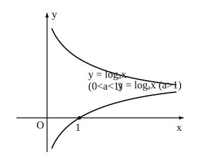

运算性质：

$$\log_a(MN)=\log_a M+\log_a N$$

$$\log_a\frac{M}{N}=\log_a M-\log_a N$$

$$\log_a M^N=N\log_a M$$

$$\log_a M^{-1}=-\log_a M$$

$$a^b=e^{b\ln a}$$

$$\log_a b=\frac{\log_c b}{\log_c a}$$

### （5）三角函数

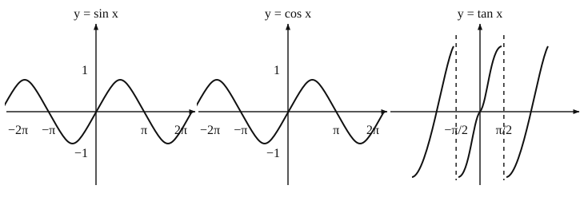

| 函数 | 定义域 $D$ | 值域 $R$ | 周期 $T$ | 奇偶性 |
| --- | --- | --- | --- | --- |
| $y=\sin x$ | $(-\infty,+\infty)$ | $[-1,1]$ | $2\pi$ | 奇函数 |
| $y=\cos x$ | $(-\infty,+\infty)$ | $[-1,1]$ | $2\pi$ | 偶函数 |
| $y=\tan x$ | $\{x\mid x\ne k\pi+\frac{\pi}{2},\ k\in\mathbb{Z}\}$ | $(-\infty,+\infty)$ | $\pi$ | 奇函数 |

其余三角函数：

$$y=\cot x=\frac{\cos x}{\sin x},\qquad y=\sec x=\frac{1}{\cos x},\qquad y=\csc x=\frac{1}{\sin x}$$

## 7. 反三角函数

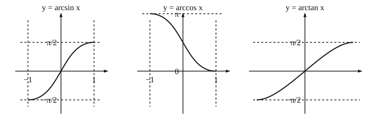

| 函数 | 定义域 $D$ | 值域 $R$ | 奇偶性 |
| --- | --- | --- | --- |
| $y=\arcsin x$ | $[-1,1]$ | $\left[-\frac{\pi}{2},\frac{\pi}{2}\right]$ | 奇函数 |
| $y=\arccos x$ | $[-1,1]$ | $[0,\pi]$ | 非奇非偶 |
| $y=\arctan x$ | $(-\infty,+\infty)$ | $\left(-\frac{\pi}{2},\frac{\pi}{2}\right)$ | 奇函数 |

## 8. 特殊函数

### （1）绝对值函数

$$y=|x|=\begin{cases} x, & x>0\\ 0, & x=0\\ -x, & x<0 \end{cases}$$

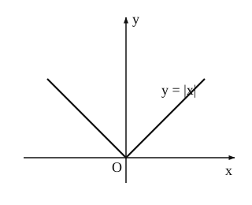

### （2）符号函数

$$y=\operatorname{sgn} x=\begin{cases} 1, & x>0\\ 0, & x=0\\ -1, & x<0 \end{cases}$$

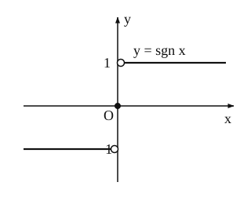

### （3）取整函数

$y=[x]$，表示不超过 $x$ 的最大整数。例如：$[2.718]=2$，$[-2.718]=-3$。

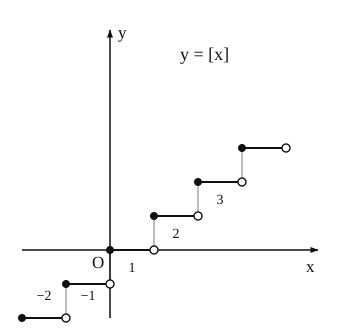

### （4）狄利克雷函数

$$D(x)=\begin{cases} 1, & x\in\mathbb{Q}\\ 0, & x\notin\mathbb{Q} \end{cases}$$

### 📝 例题 4
**【题目】**：已知 $f(x)=\sin x$，$f[\varphi(x)]=1-x^2$，则 $\varphi(x)=$ ____，其定义域为 ____。

**【解析】**：由题设，

$$f[\varphi(x)]=\sin\varphi(x)=1-x^2$$

$$\varphi(x)=\arcsin(1-x^2)$$

定义域满足：

$$-1\le 1-x^2\le 1$$

$$\Rightarrow\ 0\le x^2\le 2$$

$$\Rightarrow\ -\sqrt{2}\le x\le \sqrt{2}$$

### 📝 例题 5
**【题目】**：设 $f(x)=e^{x^2}$，$f[\varphi(x)]=1-x$，且 $\varphi(x)\ge 0$，求 $\varphi(x)$ 及其定义域。

**【解析】**：由题设，

$$f[\varphi(x)]=e^{\varphi(x)^2}=1-x$$

$$\varphi(x)=\sqrt{\ln(1-x)}$$

定义域需满足：

$$\begin{cases} 1-x>0\\ \ln(1-x)\ge 0 \end{cases}\ \Rightarrow\ \begin{cases} x<1\\ 1-x\ge 1 \end{cases}\ \Rightarrow\ x\le 0$$

故定义域为 $(-\infty,0]$。

### 📝 例题 6
**【题目】**：已知 $3f(x)+f(2-x)=x^2$，求 $f(x)$。

**【解析】**：令 $t=2-x$，则 $x=2-t$，代入原式得：

$$3f(2-t)+f(t)=(2-t)^2$$

换回 $x$，与原式联立：

$$\begin{cases} 3f(x)+f(2-x)=x^2 & \cdots ①\\ 3f(2-x)+f(x)=(2-x)^2 & \cdots ② \end{cases}$$

$①\times 3-②$ 得：

$$8f(x)=3x^2-(2-x)^2=2x^2+4x-4$$

$$\boxed{\,f(x)=\dfrac{1}{4}\left(x^2+2x-2\right)\,}$$

### 📝 例题 7
**【题目】**：已知 $3f(x)+f\left(\dfrac{1}{x}\right)=x^2$，求 $f(x)$。

**【解析】**：原式记为 ①：

$$3f(x)+f\left(\dfrac{1}{x}\right)=x^2 \quad \cdots ①$$

令 $t=\dfrac{1}{x}$，则 $x=\dfrac{1}{t}$，代入得：

$$3f\left(\dfrac{1}{x}\right)+f(x)=\dfrac{1}{x^2} \quad \cdots ②$$

$②-3\times ①$ 得：

$$-8f(x)=\dfrac{1}{x^2}-3x^2$$

$$\boxed{\,f(x)=\dfrac{1}{8}\left(3x^2-\dfrac{1}{x^2}\right)\ (x\ne 0)\,}$$

---

# 第02节 函数的性质、复合函数与反函数

## 1. 函数的性质

函数的性质包括：奇偶性、单调性、有界性、周期性。

### （1）奇偶性

定义域 $D$ 关于原点对称。

- 若 $f(-x)=-f(x)$，则称 $f(x)$ 是**奇函数**（图像关于原点对称）；
- 若 $f(-x)=f(x)$，则称 $f(x)$ 是**偶函数**（图像关于 $y$ 轴对称）。

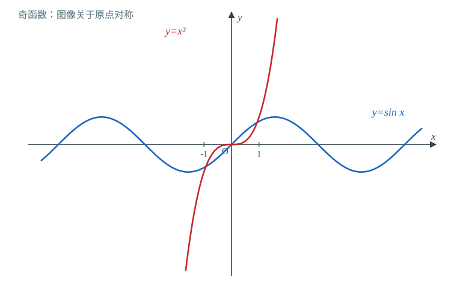

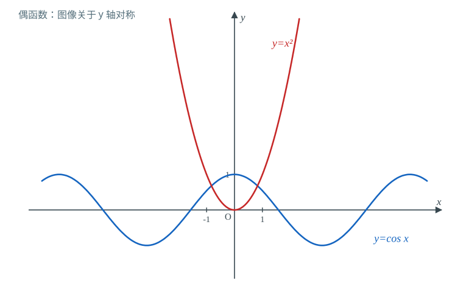

判断奇偶性的两个步骤：① 考察定义域 $D$ 是否关于原点对称；② 考察 $f(-x)$ 与 $f(x)$ 之间的关系。

### 📝 例题 1

**【题目】**：判断 $f(x)=\ln\left(x+\sqrt{1+x^2}\right)$ 的奇偶性。

**【解析】**：由题设，$f(x)$ 的定义域为

$$\begin{cases} 1+x^2\ge 0\\ x+\sqrt{1+x^2}>0 \end{cases}\ \Rightarrow\ -\infty<x<+\infty$$

定义域关于原点对称。

$$f(-x)=\ln\left(-x+\sqrt{1+x^2}\right)=\ln\left(\sqrt{1+x^2}-x\right)$$

$$=\ln\frac{\left(\sqrt{1+x^2}-x\right)\left(\sqrt{1+x^2}+x\right)}{\sqrt{1+x^2}+x}=\ln\frac{1}{\sqrt{1+x^2}+x}$$

$$=-\ln\left(x+\sqrt{1+x^2}\right)=-f(x)$$

故 $f(x)$ 是奇函数。

根式有理化：

$$\sqrt{a}-\sqrt{b}=\frac{\left(\sqrt{a}-\sqrt{b}\right)\left(\sqrt{a}+\sqrt{b}\right)}{\sqrt{a}+\sqrt{b}}=\frac{a-b}{\sqrt{a}+\sqrt{b}},\qquad \sqrt{a}-b=\frac{\left(\sqrt{a}-b\right)\left(\sqrt{a}+b\right)}{\sqrt{a}+b}=\frac{a-b^{2}}{\sqrt{a}+b}$$

奇偶性的常用结论：

- 奇 $+$ 奇 $=$ 奇，偶 $+$ 偶 $=$ 偶；奇 $\times$ 奇 $=$ 偶，偶 $\times$ 偶 $=$ 偶，奇 $\times$ 偶 $=$ 奇。
- 若 $F(x)$ 是可导的**奇函数**，则 $F'(x)$ 是**偶函数**；若 $F(x)$ 是可导的**偶函数**，则 $F'(x)$ 是**奇函数**。
- 若 $f(x)$ 是**奇函数**，则 $F(x)=\displaystyle\int_0^x f(t)\,\mathrm{d}t$ 是**偶函数**；若 $f(x)$ 是**偶函数**，则 $F(x)=\displaystyle\int_0^x f(t)\,\mathrm{d}t$ 是**奇函数**。

### 📝 例题 2

**【题目】**：判断 $f(x)=\ln\dfrac{1+x}{1-x}$ 的奇偶性。

**【解析】**：由题设，$f(x)$ 的定义域为

$$\begin{cases} 1+x\ne 0\\[6pt] \dfrac{1+x}{1-x}>0 \end{cases}\ \Rightarrow\ \begin{cases} x\ne -1\\ (1+x)(1-x)>0 \end{cases}\ \Rightarrow\ -1<x<1$$

$$f(-x)=\ln\frac{1-x}{1+x}=\ln\left(\frac{1+x}{1-x}\right)^{-1}=-\ln\frac{1+x}{1-x}=-f(x)$$

故 $f(x)$ 为奇函数。

### 📝 例题 3

**【题目】**：$f(x)=|x\sin x|\,e^{\cos x}$ 在 $-\infty<x<+\infty$ 上是（　　）

- (A) 有界函数
- (B) 单调函数
- (C) 周期函数
- (D) 偶函数

**【解析】**：由题设，$f(x)$ 的定义域为 $(-\infty,+\infty)$，关于原点对称。

$$f(-x)=|(-x)\cdot\sin(-x)|\cdot e^{\cos(-x)}=|x\sin x|\cdot e^{\cos x}=f(x)$$

故 $f(x)$ 是偶函数，答案选 **D**。

### （2）单调性

当 $x_1<x_2$ 时：

- $f(x_1)<f(x_2)$，称 $f(x)$ **单调增**；
- $f(x_1)\le f(x_2)$，称 $f(x)$ **单调不减**。

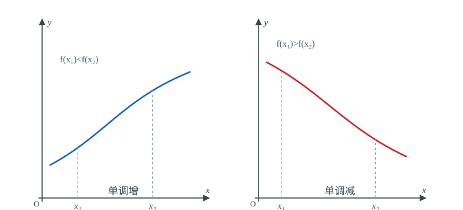

$f(x)$ 的单调性可由 $f'(x)$ 的符号判断；$f(x)$ 的单调性与奇偶性也有关联。

### （3）有界性

设 $f(x)$ 的定义域为 $D$，数集 $X\subset D$。

- 若存在 $M$，使 $f(x)\le M,\ \forall x\in X$，称 $f(x)$ 在 $X$ 上有**上界** $M$；
- 若存在 $m$，使 $f(x)\ge m,\ \forall x\in X$，称 $f(x)$ 在 $X$ 上有**下界** $m$；
- 若 $m\le f(x)\le M,\ \forall x\in X$，称 $f(x)$ 在 $X$ 上**有界**。

有界指既有上界又有下界。若 $f(x)$ 在 $[a,b]$ 上**连续**，则 $f(x)$ 在 $[a,b]$ 上**有界**。

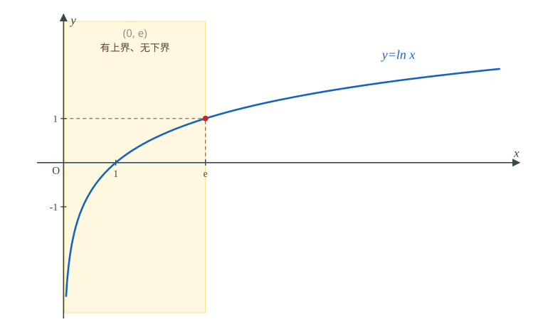

以 $y=\ln x$ 为例：在 $(0,e)$ 上有上界（$y(e)=1$），却没有下界（$x\to 0^{+}$ 时 $y\to-\infty$）。

### 📝 例题 4

**【题目】**：判断函数 $f(x)=\dfrac{x^{2}-1}{x^{2}+1}$ 的有界性。

**【解析】**：由题设，

$$f(x)=\frac{x^{2}-1}{x^{2}+1}=1-\frac{2}{x^{2}+1}$$

由于 $x^{2}+1\ge 1$，故 $0<\dfrac{2}{x^{2}+1}\le 2$，从而

$$-1\le f(x)<1$$

故 $f(x)$ 在 $(-\infty,+\infty)$ 上有界（$|f(x)|\le 1$）。

### 📝 例题 5

**【题目】**：设函数 $f(x)=x\tan x\,e^{\sin x}$，则 $f(x)$ 是（　　）

- (A) 偶函数
- (B) 无界函数
- (C) 周期函数
- (D) 单调函数

**【解析】**：由题设，逐项考察：

- （A）$f(-x)=(-x)\tan(-x)e^{\sin(-x)}=x\tan x\,e^{-\sin x}\ne f(x)$，不是偶函数；
- （B）当 $x\to\dfrac{\pi}{2}$ 时，$f(x)\to\infty$，**无界**；✓
- （C）$x$ 不是周期函数；
- （D）$\tan x$ 不是单调函数。

故答案选 **B**。

### （4）周期性

- 若 $f(x+T)=f(x)$（$T>0$），称 $f(x)$ 是以 $T$ 为周期的**周期函数**；
- 若存在最小正数 $T$，称 $T$ 为**最小正周期**。

狄利克雷函数没有最小正周期。

$$\int_a^{a+T}f(x)\,\mathrm{d}x=\int_0^{T}f(x)\,\mathrm{d}x=\int_{-\frac{T}{2}}^{\frac{T}{2}}f(x)\,\mathrm{d}x,\qquad \int_a^{a+nT}f(x)\,\mathrm{d}x=n\int_0^{T}f(x)\,\mathrm{d}x$$

### 📝 例题 6

**【题目】**：求下列周期函数的周期：
（1）$f(x)=\sin^{4}x-\cos^{4}x$
（2）$f(x)=\sin^{6}x+\cos^{6}x$

**【解析】**：

（1）

$$f(x)=\left(\sin^{2}x+\cos^{2}x\right)\left(\sin^{2}x-\cos^{2}x\right)=\sin^{2}x-\cos^{2}x=-\cos 2x$$

故 $f(x)$ 的最小正周期为 $T=\dfrac{2\pi}{2}=\pi$。

（2）

$$f(x)=\left(\sin^{2}x+\cos^{2}x\right)\left(\sin^{4}x-\sin^{2}x\cos^{2}x+\cos^{4}x\right)$$

$$=\left(\sin^{2}x+\cos^{2}x\right)^{2}-3\sin^{2}x\cos^{2}x=1-\frac{3}{4}\left(2\sin x\cos x\right)^{2}=1-\frac{3}{4}\sin^{2}2x$$

$$=1-\frac{3}{4}\cdot\frac{1-\cos 4x}{2}=\frac{5}{8}+\frac{3}{8}\cos 4x$$

故 $f(x)$ 的最小正周期 $T=\dfrac{2\pi}{4}=\dfrac{\pi}{2}$。

求三角函数的周期时，优先考虑**降幂**。立方和差公式：

$$a^{3}+b^{3}=(a+b)\left(a^{2}-ab+b^{2}\right),\qquad a^{3}-b^{3}=(a-b)\left(a^{2}+ab+b^{2}\right)$$

### 📝 例题 7

**【题目】**：当 $x\in[0,\pi]$ 时，$f(x)>0$，且 $f(x+\pi)=f(x)+\sin x$，则在 $(0,+\infty)$ 内 $f(x)$ 是（　　）
A. 以 $\pi$ 为周期的函数　B. 以 $2\pi$ 为周期的函数　C. 以 $3\pi$ 为周期的函数　D. 周期函数

**【解析】**：由题设，

$$f(x+2\pi)=f(x+\pi+\pi)=f(x+\pi)+\sin(x+\pi)=f(x)+\sin x-\sin x=f(x)$$

故 $f(x)$ 的周期 $T=2\pi$，答案选 **B**。

### 📝 例题 8

**【题目】**：函数 $f(x)=xe^{-x^{2}}(2-\cos x)$ 在 $(-\infty,+\infty)$ 上是（　　）
A. 有界的偶函数　B. 无界的偶函数　C. 有界的奇函数　D. 无界的奇函数

**【解析】**：由题设，记 $f(x)=h(x)\cdot g(x)=xe^{-x^{2}}\cdot(2-\cos x)$。

① $h(-x)=(-x)e^{-(-x)^{2}}=-xe^{-x^{2}}=-h(x)$，故 $h(x)$ 为奇函数；

② $g(-x)=2-\cos(-x)=2-\cos x=g(x)$，故 $g(x)$ 为偶函数。

奇函数与偶函数之积为奇函数，故 $f(x)$ 为奇函数。

③ $g(x)=2-\cos x$ 为有界函数，$1\le g(x)\le 3$。再证 $h(x)=xe^{-x^{2}}$ 有界：

$$h'(x)=e^{-x^{2}}+xe^{-x^{2}}(-2x)=(1-2x^{2})e^{-x^{2}}=0\ \Rightarrow\ x=\pm\frac{1}{\sqrt{2}}$$

$h(x)$ 是奇函数，只需讨论 $x\ge 0$ 的情形：

| $x$ | $\left(0,\dfrac{1}{\sqrt{2}}\right)$ | $\dfrac{1}{\sqrt{2}}$ | $\left(\dfrac{1}{\sqrt{2}},+\infty\right)$ |
| :---: | :---: | :---: | :---: |
| $h'(x)$ | $+$ | $0$ | $-$ |
| $h(x)$ | $\nearrow$ | 极大 | $\searrow$ |

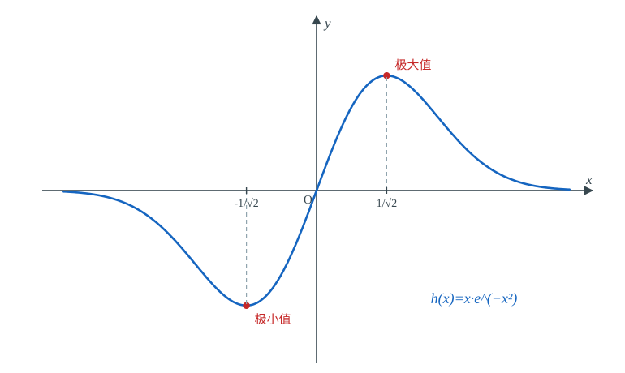

又 $h(0)=0$，$\displaystyle\lim_{x\to+\infty}h(x)=\lim_{x\to+\infty}xe^{-x^{2}}=0$，故 $h(x)$ 有界，从而 $f(x)$ 有界。

故答案选 **C**。

### 📝 例题 9

**【题目】**：设 $F(x)$ 是连续函数 $f(x)$ 的一个原函数，"$M\Leftrightarrow N$"表示"M 的充分必要条件"，则必有（　　）

（A）$F(x)$ 是偶函数 $\Leftrightarrow$ $f(x)$ 是奇函数
（B）$F(x)$ 是奇函数 $\Leftrightarrow$ $f(x)$ 是偶函数
（C）$F(x)$ 是周期函数 $\Leftrightarrow$ $f(x)$ 是周期函数
（D）$F(x)$ 是单调函数 $\Leftrightarrow$ $f(x)$ 是单调函数

**【解析】**：逐项用反例排除：

- （B）取 $f(x)=x^{2}$（偶函数），则 $F(x)=\dfrac{1}{3}x^{3}+C$，当 $C\ne0$ 时不是奇函数，故（B）不成立；
- （C）取 $F(x)=x+\sin x$（非周期函数），而 $f(x)=1+\cos x$ 是周期函数，故（C）不成立；
- （D）取 $f(x)=2x$（单调函数），则 $F(x)=x^{2}+C$ 不是单调函数，故（D）不成立；
- （A）$F(x)$ 是偶函数 $\Leftrightarrow$ $f(x)$ 是奇函数成立（如 $F(x)=x^{2}+C$，$f(x)=2x$）。

故答案选 **A**。

## 2. 复合函数

设 $y=f(u)$，$u=g(x)$，则 $y=f(g(x))$，其中 $u$ 称为中间变量。

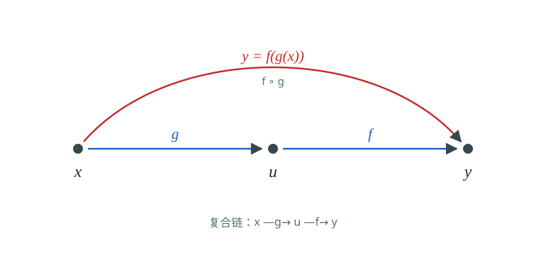

复合的条件：$g$ 的值域与 $f$ 的定义域有公共部分，即

$$R_{g}\cap D_{f}\ne\varnothing$$

### 📝 例题 10

**【题目】**：设 $f(x)=\begin{cases}e^{x},& x<1\\ x,& x\ge1\end{cases}$，$\varphi(x)=\begin{cases}x+2,& x<0\\ x^{2}-1,& x\ge0\end{cases}$，求 $f[\varphi(x)]$。

**【解析】**：由题设，

$$f(\varphi(x))=\begin{cases}e^{\varphi(x)},& \varphi(x)<1\\ \varphi(x),& \varphi(x)\ge1\end{cases}$$

① 当 $\varphi(x)=x+2<1$（即 $x<-1$）时，$f(\varphi(x))=e^{x+2}$；

② 当 $\varphi(x)=x^{2}-1<1$（即 $0\le x<\sqrt{2}$）时，$f(\varphi(x))=e^{x^{2}-1}$；

③ 当 $\varphi(x)=x+2\ge1$（即 $-1\le x<0$）时，$f(\varphi(x))=x+2$；

④ 当 $\varphi(x)=x^{2}-1\ge1$（即 $x\ge\sqrt{2}$）时，$f(\varphi(x))=x^{2}-1$。

综上所述，

$$f(\varphi(x))=\begin{cases}e^{x+2},& x<-1\\[4pt] e^{x^{2}-1},& 0\le x<\sqrt{2}\\[4pt] x+2,& -1\le x<0\\[4pt] x^{2}-1,& x\ge\sqrt{2}\end{cases}$$

### 📝 例题 11

**【题目】**：设函数 $f(x)=\dfrac{x}{1+x}$，$x\in[0,1]$，令 $f_1(x)=f(x)$，$f_2(x)=f(f_1(x))$，……，$f_n(x)=f(f_{n-1}(x))$，求 $f_n(x)$。

**【解析】**：用归纳法证明 $f_n(x)=\dfrac{x}{1+nx}$。

当 $n=1$ 时，$f_1(x)=f(x)=\dfrac{x}{1+x}$，结论成立。

假设当 $n=k$ 时 $f_k(x)=\dfrac{x}{1+kx}$，则当 $n=k+1$ 时，

$$f_{k+1}(x)=f(f_k(x))=\frac{f_k(x)}{1+f_k(x)}=\frac{\dfrac{x}{1+kx}}{1+\dfrac{x}{1+kx}}=\frac{x}{1+(k+1)x}$$

故对一切正整数 $n$，有 $f_n(x)=\dfrac{x}{1+nx}$。

## 3. 反函数

设 $y=x^{3}$：$x=2\xrightarrow{\ f\ }y=8$；反过来 $y=27\xrightarrow{\ g\ }x=3$，则 $f$ 与 $g$ 互为**反函数**。

$$y=f(x)\ \begin{cases} x=g(y) & \text{——第一种形式反函数，与 } y=f(x) \text{ 图像重合}\\[10pt] y=g(x) & \text{——第二种形式反函数，与 } y=f(x) \text{ 关于 } y=x \text{ 对称} \end{cases}$$

第二种形式反函数 $y=g(x)$ 相当于把 $x$ 与 $y$ 互换：$y=f(x)$ 的定义域与值域，恰好分别是 $y=g(x)$ 的值域与定义域。

### 📝 例题 12

**【题目】**：求函数 $y=\ln\left(x+\sqrt{x^{2}-1}\right)$（$x\ge1$）的反函数。

**【解析】**：由题设，当 $x\ge1$ 时 $y\ge0$，故反函数的定义域为 $[0,+\infty)$。

由 $x+\sqrt{x^{2}-1}=e^{y}$，两边取倒数并变形得 $x-\sqrt{x^{2}-1}=e^{-y}$（因 $\left(x+\sqrt{x^{2}-1}\right)\left(x-\sqrt{x^{2}-1}\right)=1$）。

两式相加：

$$2x=e^{y}+e^{-y}\ \Rightarrow\ x=\frac{1}{2}\left(e^{y}+e^{-y}\right)$$

交换 $x$ 与 $y$，得反函数

$$y=\frac{1}{2}\left(e^{x}+e^{-x}\right),\quad x\in[0,+\infty)$$

### 📝 例题 13

**【题目】**：设 $f(x)=\begin{cases}1-2x^{2},& x<-1\\ x^{3},& -1\le x\le2\\ 12x-16,& x>2\end{cases}$，写出 $f(x)$ 的反函数 $g(x)$ 的表达式。

**【解析】**：分段求反函数：

① 当 $x<-1$ 时，$y=1-2x^{2}$。由 $x^{2}>(-1)^{2}$ 得 $-2x^{2}<-2$，即 $y=1-2x^{2}<-1$，故这一段反函数的定义域为 $x<-1$。由 $y=1-2x^{2}$ 解得 $x^{2}=\dfrac{1-y}{2}$，又 $x<-1$ 取负号，得 $x=-\sqrt{\dfrac{1-y}{2}}$，故

$$g(x)=-\sqrt{\frac{1-x}{2}},\quad x<-1$$

② 当 $-1\le x\le2$ 时，$y=x^{3}$，则 $x=y^{\frac{1}{3}}$，且 $-1\le y=x^{3}\le8$，故

$$g(x)=x^{\frac{1}{3}},\quad -1\le x\le8$$

③ 当 $x>2$ 时，$y=12x-16$，则 $x=\dfrac{1}{12}(y+16)$，且 $x>2\Rightarrow 12x-16>24-16\Rightarrow y>8$，故

$$g(x)=\frac{1}{12}(x+16),\quad x>8$$

综上所述，

$$g(x)=\begin{cases}-\sqrt{\dfrac{1-x}{2}},& x<-1\\[12pt] x^{\frac{1}{3}},& -1\le x\le8\\[12pt] \dfrac{1}{12}(x+16),& x>8\end{cases}$$

---

# 第03节 数列极限

## 1. 数列极限的定义

### （1）数列极限

> 💡 **[旁注]**：数列变化趋势（位置：原图"数列极限"四字右侧，红字）

> 📌 **[知识点]**：极限 = 有限、确定的数（不无限大）（位置：原图顶部，红蓝字）

- $x_n = \dfrac{1}{n}$：$1, \dfrac{1}{2}, \dfrac{1}{3}, \cdots, \dfrac{1}{n}, \cdots$，$\lim\limits_{n\to\infty} x_n = \lim\limits_{n\to\infty} \dfrac{1}{n} = 0$
- $y_n = (-1)^{n+1}$：$1, -1, 1, \cdots, (-1)^{n+1}, \cdots$，$\lim\limits_{n\to\infty} y_n = \lim\limits_{n\to\infty} (-1)^{n+1} =$ 不存在（振荡）
- $z_n = n$：$1, 2, 3, \cdots, n, \cdots$，$\lim\limits_{n\to\infty} z_n = \lim\limits_{n\to\infty} n = +\infty$ 不存在（无穷大）

> 💡 **[旁注]**：振荡和无穷大时，极限不存在（位置：原图三个例子下方，红字）

> 💡 **[旁注]**：$\lim\limits_{n\to\infty} \dfrac{(-1)^{n+1}}{n} = 0$（位置：原图右侧，蓝字）

> 💡 **[旁注]**：箭头指向"变化趋势"（位置：原图 $z_n$ 一行右侧）

$$\lim_{n\to\infty} x_n = a \quad \text{或} \quad x_n \to a \ (n\to\infty)$$

$$\forall \varepsilon > 0,\ \exists N,\ s.t.\ n > N\ \text{时},\ |x_n - a| < \varepsilon$$

> 📌 **[知识点]**：$\forall$ = 任意，$\exists$ = 存在，$s.t.$ = 使得（位置：原图符号下方红字标注）

> 💡 **[旁注]**：当 $n$ 充分大时，$x_n$ 充分接近 $a$（位置：原图定义式下方，红字）

### （2）极限的性质

**Ⅰ 唯一性**：$\{x_n\}$ 收敛于 $a$，$\lim\limits_{n\to\infty} x_n = a$，则 $a$ 唯一。

**Ⅱ 有界性**：$\{x_n\}$ 收敛于 $a$，$\lim\limits_{n\to\infty} x_n = a$，则 $\{x_n\}$ 有界。

> 💡 **[旁注]**：存在并有界（位置：原图Ⅰ、Ⅱ两条右侧，红字）

**Ⅲ 保号性**：当 $\lim\limits_{n\to\infty} x_n = a$ 时，

> 💡 **[旁注]**：近朱者赤，近墨者黑（位置：原图保号性右侧，红字）

- 若 $a > 0$ 时，则当 $n$ 充分大时，$x_n > 0$
- 若 $x_n > 0$ 时，则 $a \geq 0$

> 💡 **[旁注]**：$x_n = \dfrac{1}{n} > 0 \Rightarrow \lim\limits_{n\to\infty} x_n = 0 \geq 0$（位置：原图右侧，蓝字）

### （3）子列收敛判别法

$$\lim_{n\to\infty} x_n = a \Leftrightarrow \lim_{n\to\infty} x_{2n} = \lim_{n\to\infty} x_{2n-1} = a$$

### 📝 例题 1

**【题目】**：设 $\lim\limits_{n\to\infty} a_n = a$，且 $a \neq 0$，则当 $n$ 充分大时有（ ）

- (A) $|a_n| > \dfrac{|a|}{2}$
- (B) $|a_n| < \dfrac{|a|}{2}$
- (C) $a_n > a - \dfrac{1}{n}$
- (D) $a_n < a + \dfrac{1}{n}$

**【解析】**：由题设 $\lim\limits_{n\to\infty} a_n = a$（$a \neq 0$），取 $\varepsilon = \dfrac{|a|}{2} > 0$，则存在 $N$，当 $n > N$ 时

$$|a_n - a| < \frac{|a|}{2} \ \Rightarrow\ |a_n| > |a| - \frac{|a|}{2} = \frac{|a|}{2}$$

故答案选 **(A)**。

### 📝 例题 2

**【题目】**：设 $\{a_n\}$ 是数列，下列**不正确**的是（ ）

- (A) 若 $\lim\limits_{n\to\infty} x_n = a$，则 $\lim\limits_{n\to\infty} x_{2n} = \lim\limits_{n\to\infty} x_{2n+1} = a$
- (B) 若 $\lim\limits_{n\to\infty} x_{2n} = \lim\limits_{n\to\infty} x_{2n+1} = a$，则 $\lim\limits_{n\to\infty} x_n = a$
- (C) 若 $\lim\limits_{n\to\infty} x_n = a$，则 $\lim\limits_{n\to\infty} x_{3n} = \lim\limits_{n\to\infty} x_{3n+1} = a$
- (D) 若 $\lim\limits_{n\to\infty} x_{3n} = \lim\limits_{n\to\infty} x_{3n+1} = a$，则 $\lim\limits_{n\to\infty} x_n = a$

**【解析】**：由题设

> ⚠️ **[智能体A注]**：题干中数列记为 $\{a_n\}$，而四个选项均使用 $x_n$，前后记号不一致，疑为转写（或原笔记）笔误；按题意二者应指同一数列。

- （A）正确：数列收敛于 $a$ 时，其任一子列 $\{x_{2n}\}$、$\{x_{2n+1}\}$ 都收敛于 $a$。
- （B）正确：偶数项子列与奇数项子列都以 $a$ 为极限，则原数列必以 $a$ 为极限。
- （C）正确：同（A），$\{x_{3n}\}$、$\{x_{3n+1}\}$ 都是 $\{x_n\}$ 的子列。

> 💡 **[旁注]**：$\lim\limits_{n\to\infty} x_n = a \Leftrightarrow \lim\limits_{n\to\infty} x_{3n} = \lim\limits_{n\to\infty} x_{3n+1} = \lim\limits_{n\to\infty} x_{3n+2} = a$（位置：原图解析中间，蓝字）

- （D）错误：缺少 $\lim\limits_{n\to\infty} x_{3n+2} = a$ 这一条件，三个子列不全，不能推出原数列收敛。

故不正确的是 **(D)**。

## 2. 根式有理化

> 💡 **[旁注]**：根式相减时，优先考虑根式有理化（位置：原图标题右侧，红字）

$$\sqrt{a} - \sqrt{b} = \frac{(\sqrt{a}-\sqrt{b})(\sqrt{a}+\sqrt{b})}{\sqrt{a}+\sqrt{b}} = \frac{a-b}{\sqrt{a}+\sqrt{b}}$$

$$\sqrt{a} - b = \frac{(\sqrt{a}-b)(\sqrt{a}+b)}{\sqrt{a}+b} = \frac{a-b^2}{\sqrt{a}+b}$$

### 📝 例题 3

**【题目】**：$\lim\limits_{n\to\infty} \left(\sqrt{n+3\sqrt{n}} - \sqrt{n-\sqrt{n}}\right)$

**【解析】**：

$$\text{原式} = \lim_{n\to\infty} \frac{n+3\sqrt{n}-(n-\sqrt{n})}{\sqrt{n+3\sqrt{n}}+\sqrt{n-\sqrt{n}}} = \lim_{n\to\infty} \frac{4\sqrt{n}}{\sqrt{n+3\sqrt{n}}+\sqrt{n-\sqrt{n}}}$$

$$= \lim_{n\to\infty} \frac{4}{\sqrt{1+\frac{3}{\sqrt{n}}}+\sqrt{1-\frac{1}{\sqrt{n}}}} = \frac{4}{1+1} = 2$$

> 💡 **[旁注]**：$\dfrac{\infty}{\infty}$ 型，分子、分母除以最大项（位置：原图例3右侧，红字）

> 💡 **[旁注]**：数列极限 $\to$ 连续化 $\to$ 洛必达（位置：原图例3下方，红字带箭头）

## 3. 数列和的极限

> 📌 **[知识点]**：求和符号：$\sum$，$\sum\limits_{k=1}^{n} f(k) = f(1) + f(2) + \cdots + f(n)$

> 📌 **[知识点]**：连乘符号：$\prod$（位置：原图"求和符号"下方，蓝字）

$$\sum_{k=1}^{n} f(k) = f(1) + f(2) + \cdots + f(n)$$

$$\sum_{k=1}^{n} 1 = \underbrace{1+1+\cdots+1}_{n} = n$$

$$\sum_{k=1}^{n} k = 1+2+3+\cdots+(n-2)+(n-1)+n = \frac{n(n+1)}{2}$$

$$\sum_{k=1}^{n} k^2 = 1^2+2^2+3^2+\cdots+n^2 = \frac{n(n+1)(2n+1)}{6}$$

### （1）等比数列和的极限

> 💡 **[旁注]**：先求有限项的和 $\to$ 再取极限（位置：原图右上角，红字）

### 📝 例题 4

**【题目】**：设 $a \neq 0$，求 $\lim\limits_{n\to\infty} \left(a + aq + aq^2 + \cdots + aq^{n-1}\right)$

**【解析】**：由题设

$$S_n = a + aq + aq^2 + \cdots + aq^{n-1} \quad \cdots ①$$

$$qS_n = aq + aq^2 + aq^3 + \cdots + aq^n \quad \cdots ②$$

①$-$②得：$(1-q)S_n = a(1-q^n)$

- 当 $q \neq 1$ 时，$S_n = \dfrac{a(1-q^n)}{1-q}$

> 💡 **[旁注]**：有限项等比数列求和公式（位置：原图该式右侧，红字）

- 当 $|q| < 1$ 时，$\lim\limits_{n\to\infty} S_n = \lim\limits_{n\to\infty} \dfrac{a(1-q^n)}{1-q} = \dfrac{a}{1-q}$

> 💡 **[旁注]**：无穷项等比数列求和（位置：原图该式右侧，红字）

- 当 $q = 1$ 时，$\lim\limits_{n\to\infty} S_n = \lim\limits_{n\to\infty} na = +\infty$ 不存在

> ⚠️ **[智能体A注]**：严格来说，当 $q=1$ 时 $S_n = na$，极限的符号依赖于 $a$：$a>0$ 时为 $+\infty$，$a<0$ 时为 $-\infty$。原笔记只写了 $+\infty$，结论"不存在"不受影响，但表述不够严谨。
- 当 $q = -1$ 时，$\lim\limits_{n\to\infty} S_n$ 不存在 $\Leftarrow$ $\lim\limits_{n\to\infty} S_{2n+1} = a$，$\lim\limits_{n\to\infty} S_{2n} = 0$
- 当 $|q| > 1$ 时，$\lim\limits_{n\to\infty} S_n = \lim\limits_{n\to\infty} \dfrac{a(1-q^n)}{1-q} = \infty$

### 📝 例题 5

**【题目】**：$\lim\limits_{n\to\infty} \left[\dfrac{2}{3} - \left(\dfrac{2}{3}\right)^2 + \left(\dfrac{2}{3}\right)^3 + \cdots + (-1)^{n+1}\left(\dfrac{2}{3}\right)^n\right]$

**【解析】**：由题设

$$\text{原式} = \lim_{n\to\infty} \frac{\frac{2}{3}\left(1-\left(-\frac{2}{3}\right)^n\right)}{1-\left(-\frac{2}{3}\right)} = \frac{\frac{2}{3}}{1+\frac{2}{3}} = \frac{2}{5}$$

### （2）裂项化求数列和的极限

> 📌 **[知识点]**：$\dfrac{1}{k(k+1)} = \dfrac{1}{k} - \dfrac{1}{k+1}$（位置：原图右侧，蓝字）

### 📝 例题 6

**【题目】**：$\lim\limits_{n\to\infty} \sum\limits_{k=1}^{n} \dfrac{1}{k(k+1)}$

**【解析】**：由题设

$$\text{原式} = \lim_{n\to\infty} \sum_{k=1}^{n} \left(\frac{1}{k} - \frac{1}{k+1}\right) = \lim_{n\to\infty} \left(1 - \frac{1}{2} + \frac{1}{2} - \frac{1}{3} + \cdots + \frac{1}{n} - \frac{1}{n+1}\right)$$

$$= \lim_{n\to\infty} \left(1 - \frac{1}{n+1}\right) = 1$$

### 📝 例题 7

**【题目】**：$\lim\limits_{n\to\infty} \sum\limits_{k=1}^{n} \dfrac{1}{k(k+2)}$

**【解析】**：由题设

$$\text{原式} = \lim_{n\to\infty} \sum_{k=1}^{n} \frac{1}{2}\left(\frac{1}{k} - \frac{1}{k+2}\right) = \lim_{n\to\infty} \frac{1}{2}\left(1 - \frac{1}{3} + \frac{1}{2} - \frac{1}{4} + \cdots + \frac{1}{n-1} - \frac{1}{n+1} + \frac{1}{n} - \frac{1}{n+2}\right)$$

$$= \lim_{n\to\infty} \frac{1}{2}\left(1 + \frac{1}{2} - \frac{1}{n+1} - \frac{1}{n+2}\right) = \frac{1}{2} \times \frac{3}{2} = \frac{3}{4}$$

### （3）夹逼准则求数列和的极限

设数列 $\{x_n\}$ 满足

$$y_n \leq x_n \leq z_n,\quad \text{且} \lim_{n\to\infty} y_n = \lim_{n\to\infty} z_n = a$$

则 $\lim\limits_{n\to\infty} x_n = a$。

> 📌 **[知识点]**：[注]：用夹逼准则求数列和的极限：分子不动，放缩两端分母（"放缩"二字上方红字标注"通分"）

### 📝 例题 8

**【题目】**：$\lim\limits_{n\to\infty} \sum\limits_{k=1}^{n} \dfrac{1}{\sqrt{n^2+k}}$

> 💡 **[旁注]**：$\sum\limits_{k=1}^{n} \dfrac{1}{\sqrt{n^2+k}} = \dfrac{1}{\sqrt{n^2+1}} + \dfrac{1}{\sqrt{n^2+2}} + \cdots + \dfrac{1}{\sqrt{n^2+n}}$（位置：原图题目右侧，红字）

**【解析】**：由题设，分母一致 $\to$ 通分

$$\sum_{k=1}^{n} \frac{1}{\sqrt{n^2+k}} \leq \frac{1}{\sqrt{n^2+1}} + \frac{1}{\sqrt{n^2+1}} + \cdots + \frac{1}{\sqrt{n^2+1}} = \frac{n}{\sqrt{n^2+1}}$$

$$\frac{n}{\sqrt{n^2+n}} \leq \sum_{k=1}^{n} \frac{1}{\sqrt{n^2+k}}$$

又由于 $\lim\limits_{n\to\infty} \dfrac{n}{\sqrt{n^2+n}} = \lim\limits_{n\to\infty} \dfrac{1}{\sqrt{1+\frac{1}{n}}} = 1$，$\lim\limits_{n\to\infty} \dfrac{n}{\sqrt{n^2+1}} = 1$

根据夹逼准则，原式 $= 1$

### 📝 例题 9

**【题目】**：$\lim\limits_{n\to\infty} \sum\limits_{k=1}^{n} \dfrac{k}{n^2+n+k}$

> 💡 **[旁注]**：分子不动，放缩两端分母（位置：原图题目上方，蓝字）

> 💡 **[旁注]**：$\sum\limits_{k=1}^{n} \dfrac{k}{n^2+n+k} = \dfrac{1}{n^2+n+1} + \dfrac{2}{n^2+n+2} + \cdots + \dfrac{n}{n^2+n+n}$（位置：原图题目右侧，红字）

**【解析】**：由题设

$$\frac{\frac{1}{2}n(n+1)}{n^2+n+n} \leq \sum_{k=1}^{n} \frac{k}{n^2+n+k} \leq \frac{1}{n^2+n+1} + \frac{2}{n^2+n+1} + \cdots + \frac{n}{n^2+n+1} = \frac{\frac{1}{2}(n+1)n}{n^2+n+1}$$

又由于 $\lim\limits_{n\to\infty} \dfrac{\frac{1}{2}n(n+1)}{n^2+n+n} = \lim\limits_{n\to\infty} \dfrac{\frac{1}{2}+\frac{1}{2n}}{1+\frac{1}{n}+\frac{1}{n}} = \dfrac{1}{2}$，$\lim\limits_{n\to\infty} \dfrac{\frac{1}{2}n(n+1)}{n^2+n+1} = \dfrac{1}{2}$

根据夹逼准则，原式 $= \dfrac{1}{2}$

### 📝 例题 10

**【题目】**：设对任意的 $n$，总有 $y_n \leq x_n \leq z_n$，且 $\lim\limits_{n\to\infty} (z_n - y_n) = 0$，则 $\lim\limits_{n\to\infty} x_n$（ ）

(A) 存在且等于零　(B) 存在但不等于零　(C) 一定不存在　(D) 不一定存在

> 💡 **[旁注]**：原图题干末尾括号处已标记答案 (D)（位置：原图题目"则 $\lim\limits_{n\to\infty} x_n$"之后，黑字）

**【解析】**：由题设

(1) $n - \dfrac{1}{n} \leq x_n \leq n + \dfrac{1}{n}$，$\lim\limits_{n\to\infty} (z_n - y_n) = \lim\limits_{n\to\infty} \dfrac{2}{n} = 0$

但是 $\lim\limits_{n\to\infty} x_n = +\infty$，故 $\{x_n\}$ 极限不存在

(2) $a - \dfrac{1}{n} \leq x_n \leq a + \dfrac{1}{n}$，$\lim\limits_{n\to\infty} (z_n - y_n) = \lim\limits_{n\to\infty} \dfrac{2}{n} = 0$

$\lim\limits_{n\to\infty} x_n = a$，故 $\{x_n\}$ 极限存在

> ⚠️ **[智能体A注]**：原笔记解析至此未点明答案。综合 (1)(2) 两个反例/正例可知，$\lim\limits_{n\to\infty} x_n$ 可能存在也可能不存在，故应选 **(D) 不一定存在**。注意 $\lim\limits_{n\to\infty}(z_n - y_n) = 0$ 并不等价于 $\lim y_n = \lim z_n$，因此不能直接套用夹逼准则。

### （4）定积分定义求数列和的极限

$$\lim_{n\to\infty} \sum_{k=1}^{n} f\left(\frac{k}{n}\right) \cdot \frac{1}{n} = \int_{0}^{1} f(x)\, dx$$

> 📌 **[知识点]**：① $\dfrac{1}{n} \to dx$　② $\dfrac{k}{n} \to x$　③ $\sum \to \int$（位置：原图公式下方，蓝字）

> 📌 **[知识点]**：$\sum\limits_{k=1}^{k=n} \to \displaystyle\int_{x=\frac{k}{n}=\frac{1}{n}\to 0}^{x=\frac{k}{n}=\frac{n}{n}=1}$；$\sum\limits_{k=1}^{k=2n} \to \displaystyle\int_{x=\frac{k}{n}=\frac{n}{n}=1}^{x=\frac{k}{n}=\frac{2n}{n}=2}$（位置：原图右侧上下限推导，蓝字）

### 📝 例题 11

**【题目】**：$\lim\limits_{n\to\infty} \sum\limits_{k=1}^{n} \dfrac{1}{n+k}$

**【解析】**：由定积分定义

$$\text{原式} = \lim_{n\to\infty} \sum_{k=1}^{n} \frac{n}{n+k} \cdot \frac{1}{n} = \lim_{n\to\infty} \sum_{k=1}^{n} \frac{1}{1+\frac{k}{n}} \cdot \frac{1}{n}$$

$$= \int_{0}^{1} \frac{1}{1+x}\, dx = \ln(x+1)\Big|_0^1 = \ln 2$$

### 📝 例题 12

**【题目】**：$\lim\limits_{n\to\infty} n\left(\dfrac{1}{1+n^2} + \dfrac{1}{2^2+n^2} + \cdots + \dfrac{1}{n^2+n^2}\right)$

**【解析】**：由定积分定义

> ✅ **[校对说明]**：本例题干曾漏写因子 $n$（若按漏写版本计算，答案为 $0$，与解析不符）。经对照原图（IMG20261013173238），极限号后、左括号前确有因子 $n$，现已修正为 $\lim\limits_{n\to\infty} n\left(\dfrac{1}{1+n^2}+\dfrac{1}{2^2+n^2}+\cdots+\dfrac{1}{n^2+n^2}\right)$，与解析及答案 $\dfrac{\pi}{4}$ 一致。

$$\text{原式} = \lim_{n\to\infty} \sum_{k=1}^{n} n \cdot \frac{1}{k^2+n^2} = \lim_{n\to\infty} \sum_{k=1}^{n} \frac{n^2}{k^2+n^2} \cdot \frac{1}{n}$$

$$= \lim_{n\to\infty} \sum_{k=1}^{n} \frac{1}{\left(\frac{k}{n}\right)^2+1} \cdot \frac{1}{n}$$

$$= \int_{0}^{1} \frac{1}{x^2+1}\, dx = \arctan x \Big|_0^1 = \arctan 1 = \frac{\pi}{4}$$

---

# 第04节 单调有界原理

## 1. 单调有界原理

> 📌 **[知识点]**（红字，位于"1. 单调有界原理"下方）：数列极限

> 💡 **[旁注1]**（蓝字，位于红字"数列极限"右侧）：$x_n \le x_{n+1}$，$x_n \le M$

（1）数列 $\{x_n\}$ 单调增，有上界，则 $\lim\limits_{n\to\infty} x_n$ 存在；
（2）数列 $\{x_n\}$ 单调减，有下界，则 $\lim\limits_{n\to\infty} x_n$ 存在。

> 💡 **[旁注2]**（蓝字，位于第（2）条下方）：$x_n \ge x_{n+1}$，$x_n \ge m$

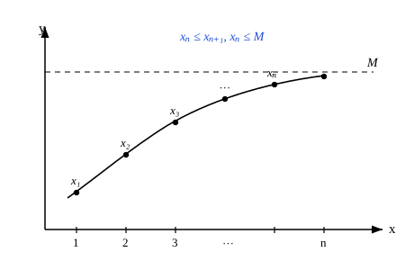

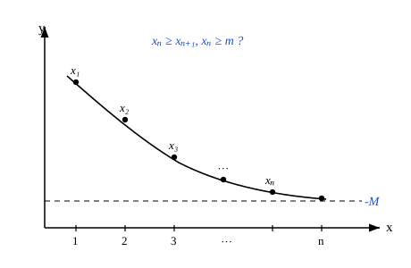

> 📌 **[注1]**（红字）：有界 $\to$ 单调 $\to$ 极限存在 $\to$ 求极限

> 📌 **[注2]**（红字）：$(a-b)^2 \ge 0 \;\Rightarrow\; a^2+b^2 \ge 2ab \;\Rightarrow\; ab \le \dfrac{a^2+b^2}{2} \;\Rightarrow\; \sqrt{ab} \le \dfrac{a+b}{2}$（$a>0,\ b>0$）重要不等式

> 📌 **[注3]**（红字）：当 $x>0$ 时，$x > \sin x$，$x > \ln(1+x)$，$e^x > 1+x$

### 📝 例题 1

**【题目】**：设 $a_1 = 2$，$a_{n+1} = \dfrac{1}{2}\left(a_n + \dfrac{1}{a_n}\right)$（$n=1,2,\cdots$），求 $\lim\limits_{n\to\infty} a_n$。

> 💡 **[思路]**：先算前几项 $a_1=2,\ a_2=\dfrac{5}{4},\ a_3=\dfrac{41}{40},\cdots$，可见 $\{a_n\}$ 单调减；若设 $\lim\limits_{n\to\infty}a_n=A$，由递推式可预判 $A=\dfrac{1}{2}\left(A+\dfrac{1}{A}\right)=1$。

**【解析】**：

由题设 $a_1 = 2 > 0$，则 $a_n > 0$，故

$$a_{n+1} = \frac{1}{2}\left(a_n + \frac{1}{a_n}\right) \ge \frac{1}{2} \cdot 2\sqrt{a_n \cdot \frac{1}{a_n}} = 1 \;\Rightarrow\; a_n \ge 1 \quad \text{即 } \{a_n\} \text{ 有下界}$$

$$a_{n+1} - a_n = \frac{1}{2}\left(a_n + \frac{1}{a_n}\right) - a_n = \frac{1-a_n^2}{2a_n} \le 0 \;\Rightarrow\; a_{n+1} \le a_n \quad \text{即 } \{a_n\} \text{ 单调减}$$

由单调有界原理，$\lim\limits_{n\to\infty} a_n$ 存在，设 $\lim\limits_{n\to\infty} a_n = A$，令 $n \to \infty$ 得：

$$a_{n+1} = \frac{1}{2}\left(a_n + \frac{1}{a_n}\right) \;\Rightarrow\; A = \frac{1}{2}\left(A + \frac{1}{A}\right)$$

解得 $A = 1$ 或 $A = -1$（×），故 $\lim\limits_{n\to\infty} a_n = 1$。

### 📝 例题 2

**【题目】**：设 $0 < x_1 < 3$，$x_{n+1} = \sqrt{x_n(3-x_n)}$，证明 $\lim\limits_{n\to\infty} x_n$ 存在，并求其值。

**【解析】**（证明）：

由题设 $0 < x_1 < 3$，则 $x_n > 0$。

$$x_{n+1} = \sqrt{x_n(3-x_n)} \le \frac{x_n + 3 - x_n}{2} = \frac{3}{2} \;\Rightarrow\; x_n \le \frac{3}{2} \quad \text{即 } \{x_n\} \text{ 有上界}$$

$$x_{n+1} - x_n = \sqrt{x_n(3-x_n)} - x_n = \frac{x_n(3-2x_n)}{\sqrt{x_n(3-x_n)} + x_n} \ge 0 \;\Rightarrow\; x_{n+1} \ge x_n \quad \text{即 } \{x_n\} \text{ 单调增}$$

由单调有界原理，$\lim\limits_{n\to\infty} x_n$ 存在，设 $\lim\limits_{n\to\infty} x_n = A$，令 $n \to \infty$，则

$$x_{n+1} = \sqrt{x_n(3-x_n)} \;\Rightarrow\; A = \sqrt{A(3-A)}$$

解得 $A = \dfrac{3}{2}$ 或 $A = 0$（舍去），故 $\lim\limits_{n\to\infty} x_n = \dfrac{3}{2}$。

### 📝 例题 3

**【题目】**：设 $x_1 = \sqrt{2}$，$x_2 = \sqrt{2+\sqrt{2}}$，$x_{n+1} = \sqrt{2+x_n}$，证明 $\lim\limits_{n\to\infty} x_n$ 存在，并求其值。

**【解析】**（证明）：

当 $n=1$ 时，有 $0 < x_1 = \sqrt{2} \le 2$。

假设当 $n=k$ 时成立 $0 < x_k \le 2$，则当 $n=k+1$ 时：

$$0 < x_{k+1} = \sqrt{2+x_k} \le \sqrt{2+2} = 2 \quad \text{故 } \{x_n\} \text{ 有上界}$$

$$x_{n+1} - x_n = \sqrt{2+x_n} - x_n = \frac{2+x_n-x_n^2}{\sqrt{2+x_n}+x_n} = \frac{(2-x_n)(1+x_n)}{\sqrt{2+x_n}+x_n} \ge 0 \;\Rightarrow\; x_{n+1} \ge x_n \quad \text{即 } \{x_n\} \text{ 单调增}$$

由单调有界原理，$\lim\limits_{n\to\infty} x_n$ 存在，设 $\lim\limits_{n\to\infty} x_n = A$，令 $n \to \infty$，则

$$x_{n+1} = \sqrt{2+x_n} \;\Rightarrow\; A = \sqrt{2+A}$$

解得 $A = 2$ 或 $A = -1$（舍），故 $\lim\limits_{n\to\infty} x_n = 2$。

### 📝 例题 4

**【题目】**：设数列 $\{x_n\}$ 满足：$0 < x_1 < \pi$，$x_{n+1} = \sin x_n$（$n=1,2,\cdots$）
(1) 证明 $\lim\limits_{n\to\infty} x_n$ 存在，并求该极限；(2) 求 $\lim\limits_{n\to\infty} \left(\dfrac{x_{n+1}}{x_n}\right)^{x_n}$。

**【解析】**：

(1) 证明：由题设，用归纳法证 $0 < x_n \le \pi$

当 $n=1$ 时，$0 < x_1 \le \pi$ 成立；假设当 $n=k$ 时，$0 < x_k \le \pi$；

当 $n=k+1$ 时，$0 < x_{k+1} = \sin x_k \le 1 \le \pi$，故 $\{x_n\}$ 有界。

$$x_{n+1} - x_n = \sin x_n - x_n \le 0 \;\Rightarrow\; x_{n+1} \le x_n \quad \text{即 } \{x_n\} \text{ 单调减}$$

由单调有界原理，$\lim\limits_{n\to\infty} x_n$ 存在，设 $\lim\limits_{n\to\infty} x_n = A$，令 $n \to \infty$，则

$$x_{n+1} = \sin x_n \;\Rightarrow\; A = \sin A$$

解得 $A = 0$，故 $\lim\limits_{n\to\infty} x_n = 0$。

（2）由（1）知 $x_n\to0$，故 $\dfrac{x_{n+1}}{x_n}=\dfrac{\sin x_n}{x_n}\to1$。又当 $x\to0$ 时 $\ln\dfrac{\sin x}{x}\sim\dfrac{\sin x}{x}-1\sim-\dfrac{x^2}{6}$，故

$$x_n\ln\frac{x_{n+1}}{x_n}=x_n\ln\frac{\sin x_n}{x_n}\sim-\frac{x_n^3}{6}\to0$$

$$\lim_{n\to\infty}\left(\frac{x_{n+1}}{x_n}\right)^{x_n}=\lim_{n\to\infty}e^{\,x_n\ln\frac{x_{n+1}}{x_n}}=e^{0}=1$$

### 📝 例题 5

**【题目】**：设 $x_1 = a$，$x_2 = b$，$x_{n+2} = \dfrac{x_n + x_{n+1}}{2}$（$n \ge 1$），证明 $\lim\limits_{n\to\infty} x_n$ 存在，并求该极限。

**【解析】**（证明）：

由题设

$$x_{n+2} - x_{n+1} = -\frac{1}{2}(x_{n+1} - x_n)$$

则

$$x_n - x_{n-1} = -\frac{1}{2}(x_{n-1} - x_{n-2}) = \left(-\frac{1}{2}\right)^2 (x_{n-2} - x_{n-3}) = \left(-\frac{1}{2}\right)^3 (x_{n-3} - x_{n-4}) = \cdots = \left(-\frac{1}{2}\right)^{n-2}(x_2 - x_1) = \left(-\frac{1}{2}\right)^{n-2}(b-a)$$

于是

$$x_n - x_{n-1} = \left(-\frac{1}{2}\right)^{n-2}(b-a)$$
$$x_{n-1} - x_{n-2} = \left(-\frac{1}{2}\right)^{n-3}(b-a)$$
$$x_{n-2} - x_{n-3} = \left(-\frac{1}{2}\right)^{n-4}(b-a)$$
$$\vdots$$
$$x_2 - x_1 = \left(-\frac{1}{2}\right)^0 (b-a)$$

$$\therefore \; x_n - x_1 = \left(-\frac{1}{2}\right)^0(b-a) + \left(-\frac{1}{2}\right)^1(b-a) + \cdots + \left(-\frac{1}{2}\right)^{n-3}(b-a) + \left(-\frac{1}{2}\right)^{n-2}(b-a)$$

$$= (b-a) \cdot \frac{1-\left(-\frac{1}{2}\right)^{n-1}}{1-\left(-\frac{1}{2}\right)}$$

则 $x_n = a + (b-a) \cdot \dfrac{2}{3}\left(1-\left(-\dfrac{1}{2}\right)^{n-1}\right)$，故

$$\lim_{n\to\infty} x_n = \lim_{n\to\infty} \left(a + \frac{2}{3}(b-a)\left(1-\left(-\frac{1}{2}\right)^{n-1}\right)\right) = \frac{1}{3}a + \frac{2}{3}b$$

---

# 第05节 重要极限和幂指转换

## 本节框架：极限（数列、函数）求法

1. 夹逼准则
2. 定积分定义
3. 单调有界原理
4. 重要极限
5. 幂指函数转换
6. 四则运算
7. 等价无穷小替换
8. 洛必达法则
9. 泰勒公式
10. 左右极限

拉格朗日中值定理、积分中值定理

## 1. 函数极限性质

$$f(x)=\begin{cases}\dfrac{x^2-1}{x-1},& x\neq 1\\[4pt] 0,& x=1\end{cases}\Rightarrow\begin{cases}x+1,& x\neq 1\\[4pt] 0,& x=1\end{cases},\quad \lim_{x\to 1}f(x)=2$$

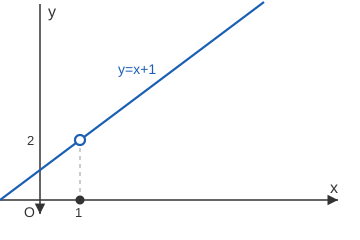

> 图像特征：直线 $y=x+1$ 在 $x=1$ 处断开（空心圈），函数值定义为 $f(1)=0$；$\lim_{x\to1}f(x)=2$ 与 $f(1)$ 无关。

**(1)** $\lim\limits_{x\to x_0}f(x)=A$，称当 $x\to x_0$ 时，$f(x)$ 以 $A$ 为极限。

> 📌 **[知识点]**（原图红字 [注]）：
> (1) $x\to x_0$ 且 $x\neq x_0$；
> (2) $\lim\limits_{x\to x_0}f(x)$ 与 $f(x)$ 表达式及自变量 $x\to x_0$ 相关；
> (3) $A$ 与 $f(x_0)$ 无关。

$$\forall\varepsilon>0,\ \exists\delta>0,\ \text{s.t. 当 } 0<|x-x_0|<\delta \text{ 时},\ |f(x)-A|<\varepsilon$$

**(2)** $\lim\limits_{x\to x_0^+}f(x)=A$，称当 $x\to x_0^+$ 时，$f(x)$ 以 $A$ 为极限（右极限）。

$$\forall\varepsilon>0,\ \exists\delta>0,\ \text{s.t. 当 } x_0<x<x_0+\delta \text{ 时},\ |f(x)-A|<\varepsilon$$

**(3)** $\lim\limits_{x\to x_0^-}f(x)=A$，称当 $x\to x_0^-$ 时，$f(x)$ 以 $A$ 为极限（左极限）。

$$\forall\varepsilon>0,\ \exists\delta>0,\ \text{s.t. 当 } x_0-\delta<x<x_0 \text{ 时},\ |f(x)-A|<\varepsilon$$

> 📌 **[知识点]**（原图红字 [定理]）：$\lim\limits_{x\to x_0}f(x)=A \iff \lim\limits_{x\to x_0^-}f(x)=\lim\limits_{x\to x_0^+}f(x)=A$

> 📌 **[知识点]**（原图蓝字 [注]）：$f(x_0-0)=\lim\limits_{x\to x_0^-}f(x)$，$f(x_0+0)=\lim\limits_{x\to x_0^+}f(x)$

**(4)** $\lim\limits_{x\to\infty}f(x)=A$，记 $f(\infty)=A$。

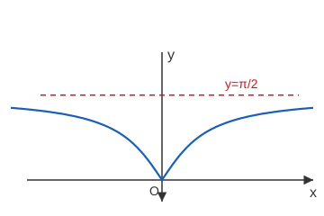

> 图像特征：$y=\arctan|x|$ 关于 $y$ 轴对称，当 $x\to\infty$ 时 $y\to\dfrac{\pi}{2}$（虚线渐近线）。

> 📌 **[知识点]**（原图红字 [注]）：$\infty$ 不是数，且 $\infty=\pm\infty$（此处 $\infty$ 同时包含 $+\infty$ 与 $-\infty$ 两个方向）

**(5)** $\lim\limits_{x\to+\infty}f(x)=A$，记 $f(+\infty)=A$。

**(6)** $\lim\limits_{x\to-\infty}f(x)=A$，记 $f(-\infty)=A$。

> 📌 **[知识点]**（原图蓝字 [定理]）：$\lim\limits_{x\to\infty}f(x)=A \iff \lim\limits_{x\to+\infty}f(x)=\lim\limits_{x\to-\infty}f(x)=A$

> 📌 **[知识点]**（原图红字 [注]）：$\lim\limits_{x\to\infty}f(x)=A$ 或 $\lim\limits_{x\to x_0}f(x)=A$ 表示六种极限的一种。

### 📝 例题 1

**【题目】**：$\lim\limits_{x\to+\infty}\left(\sqrt{x+\sqrt{x}}-\sqrt{x-\sqrt{x}}\right)$

**【解析】**：
$$\begin{aligned}\text{原式}&=\lim_{x\to+\infty}\frac{(x+\sqrt{x})-(x-\sqrt{x})}{\sqrt{x+\sqrt{x}}+\sqrt{x-\sqrt{x}}}=\lim_{x\to+\infty}\frac{2\sqrt{x}}{\sqrt{x+\sqrt{x}}+\sqrt{x-\sqrt{x}}}\\&=\lim_{x\to+\infty}\frac{2}{\sqrt{1+\frac{1}{\sqrt{x}}}+\sqrt{1-\frac{1}{\sqrt{x}}}}=\frac{2}{1+1}=1\end{aligned}$$

> 📌 **[知识点]**（原图红字 [注]，"抓大头"结论）：
> $$\lim_{x\to\infty}\frac{a_nx^n+a_{n-1}x^{n-1}+\cdots+a_1x+a_0}{b_mx^m+b_{m-1}x^{m-1}+\cdots+b_1x+b_0}=\begin{cases}0,& m>n\\[4pt] \dfrac{a_n}{b_m},& m=n\\[4pt] \infty,& m<n\end{cases}$$
> 其中 $a_n\neq 0$，$b_m\neq 0$。

### 📝 例题 2

**【题目】**：求极限 $\lim\limits_{x\to\infty}\dfrac{(2x-1)^{35}(1-x)^{15}}{(2x+1)^{50}}$

**【解析】**：
$$\text{原式}=\lim_{x\to\infty}\frac{(2x-1)^{35}\cdot(1-x)^{15}}{(2x+1)^{50}}=\lim_{x\to\infty}\frac{\left(2-\frac{1}{x}\right)^{35}\left(\frac{1}{x}-1\right)^{15}}{\left(2+\frac{1}{x}\right)^{50}}=\frac{2^{35}\cdot(-1)^{15}}{2^{50}}=-\frac{1}{2^{15}}$$

## 2. 重要极限

**(1)** $\lim\limits_{x\to\infty}\dfrac{\sin x}{x}=0$；$\lim\limits_{x\to 0}\dfrac{\sin x}{x}=1$

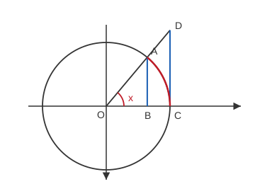

> 图像特征（单位圆中的长度比较，用于夹逼准则）：
> $$\frac{AB}{OA}=\frac{AB}{1}=\sin x \Rightarrow AB=\sin x$$
> $$\overset{\frown}{AC}=x\cdot 1 \Rightarrow \overset{\frown}{AC}=x$$
> $$\frac{CD}{OC}=\frac{CD}{1}=\tan x \Rightarrow CD=\tan x$$
> $$AB<\overset{\frown}{AC}<CD$$
> $$\sin x<x<\tan x \Rightarrow 1<\frac{x}{\sin x}<\frac{1}{\cos x}\quad\xrightarrow{\text{夹逼准则}}\ \lim_{x\to0}\frac{\sin x}{x}=1$$

### 📝 例题 3

**【题目】**：$\lim\limits_{x\to 1}\dfrac{\sin(x^2-1)}{x-1}$

**【解析】**：
$$\text{原式}=\lim_{x\to 1}\frac{\sin(x^2-1)}{x^2-1}\cdot\frac{x^2-1}{x-1}=\lim_{x\to 1}\frac{\sin(x^2-1)}{x^2-1}\cdot(x+1)=1\cdot 2=2$$

### 📝 例题 4

**【题目】**：极限 $\lim\limits_{x\to\infty}x\sin\dfrac{2x}{x^2+1}$

**【解析】**：
$$\text{原式}=\lim_{x\to\infty}\frac{\sin\dfrac{2x}{x^2+1}}{\dfrac{2x}{x^2+1}}\cdot\frac{2x^2}{x^2+1}=1\cdot 2=2$$

**(2)** $\lim\limits_{n\to\infty}\left(1+\dfrac{1}{n}\right)^n=e$

设 $x_n=\left(1+\dfrac{1}{n}\right)^n$：$x_1=2$，$x_2=\dfrac{9}{4}$，$x_3=\dfrac{64}{27}$，…，$\{x_n\}$ 单调递增 $\uparrow$

$$\begin{aligned}x_n&=\left(1+\frac{1}{n}\right)^n=\sum_{k=0}^{n}C_n^k\left(\frac{1}{n}\right)^k=\sum_{k=0}^{n}\frac{C_n^k}{n^k}\\
&=1+C_n^1\cdot\frac{1}{n}+C_n^2\cdot\frac{1}{n^2}+C_n^3\cdot\frac{1}{n^3}+\cdots+C_n^n\cdot\frac{1}{n^n}\\
&=1+n\cdot\frac{1}{n}+\frac{n(n-1)}{2}\cdot\frac{1}{n^2}+\frac{n(n-1)(n-2)}{3!}\cdot\frac{1}{n^3}+\cdots+\frac{n!}{n!}\cdot\frac{1}{n^n}\\
&\leq 1+1+\frac{1}{2!}+\frac{1}{3!}+\cdots+\frac{1}{n!}\leq 1+1+\frac{1}{2}+\frac{1}{2^2}+\cdots+\frac{1}{2^{n-1}}\\
&=1+\frac{1-\left(\frac{1}{2}\right)^n}{1-\frac{1}{2}}=1+2\left(1-\frac{1}{2^n}\right)<3\end{aligned}$$

故 $\{x_n\}$ 有上界。由单调有界原理，极限存在，记为 $e$。

$$\lim_{x\to\infty}\left(1+\frac{1}{x}\right)^x=e,\qquad \lim_{x\to 0}(1+x)^{\frac{1}{x}}=e$$

$$\lim_{x\to 0^+}\left(1+\frac{1}{x}\right)^x=1,\qquad \lim_{x\to\infty}(1+x)^{\frac{1}{x}}=1$$

> 📌 **[知识点]**（原图红字 [注]）：$(1+\text{无穷小})^{\text{无穷大}}=e$（无穷小与无穷大互为倒数）

### 📝 例题 5

**【题目】**：$\lim\limits_{n\to\infty}\left(\dfrac{n-2}{n+1}\right)^n$

**【解析】**：
$$\begin{aligned}\text{原式}&=\lim_{n\to\infty}\left(1+\frac{n-2}{n+1}-1\right)^n=\lim_{n\to\infty}\left(1-\frac{3}{n+1}\right)^n\\
&=\lim_{n\to\infty}\left(1+\frac{-3}{n+1}\right)^{\frac{n+1}{-3}\cdot\frac{-3}{n+1}\cdot n}=e^{-3}\end{aligned}$$

### 📝 例题 6

**【题目】**：设 $a$ 为非零常数，则 $\lim\limits_{x\to\infty}\left(\dfrac{x+a}{x-a}\right)^x=$

**【解析】**：
$$\begin{aligned}\text{原式}&=\lim_{x\to\infty}\left(1+\frac{x+a}{x-a}-1\right)^x=\lim_{x\to\infty}\left(1+\frac{2a}{x-a}\right)^x\\
&=\lim_{x\to\infty}\left(1+\frac{2a}{x-a}\right)^{\frac{x-a}{2a}\cdot\frac{2a}{x-a}\cdot x}=e^{2a}\end{aligned}$$

## 3. 幂指函数转化

$$f(x)^{g(x)}=e^{g(x)\ln f(x)}$$

**说明**：由指数与对数的互逆关系 $u=e^{\ln u}\ (u>0)$，取 $u=f(x)^{g(x)}$，再用对数性质 $\ln f(x)^{g(x)}=g(x)\ln f(x)$，即得

$$f(x)^{g(x)}=e^{\ln f(x)^{g(x)}}=e^{g(x)\ln f(x)}\qquad\bigl(f(x)>0\bigr)$$

### 📝 例题 7

**【题目】**：$\lim\limits_{x\to 0}(\cos x)^{\frac{1}{\ln(1+x^2)}}$

**【解析】**：
$$\text{原式}=\lim_{x\to 0}e^{\frac{\ln\cos x}{\ln(1+x^2)}}=\lim_{x\to 0}e^{\frac{\cos x-1}{x^2}}=\lim_{x\to 0}e^{\frac{-\frac{1}{2}x^2}{x^2}}=e^{-\frac{1}{2}}$$

### 📝 例题 8

**【题目】**：求 $\lim\limits_{n\to\infty}\left(n\tan\dfrac{1}{n}\right)^{n^2}$（$n$ 为自然数）

**【解析】**：（连续化：令 $x=\dfrac{1}{n}$，则 $n\to\infty\iff x\to 0^+$）
$$\begin{aligned}\text{原式}&=\lim_{x\to 0^+}\left(\frac{\tan x}{x}\right)^{\frac{1}{x^2}}=\lim_{x\to 0^+}e^{\frac{1}{x^2}\ln\frac{\tan x}{x}}\\
&=\lim_{x\to 0^+}e^{\frac{1}{x^2}\ln\left(1+\frac{\tan x}{x}-1\right)}=\lim_{x\to 0^+}e^{\frac{\tan x-x}{x^3}}\\
&=\lim_{x\to 0^+}e^{\frac{\frac{1}{3}x^3}{x^3}}=e^{\frac{1}{3}}\end{aligned}$$

## 4. 无穷小及其性质

$\lim\limits_{x\to x_0}f(x)=0$，称 $f(x)$ 是 $x\to x_0$ 时的无穷小。

> 📌 **[知识点]**（原图红字 [注]）：无穷小是表达式，"0" 是特殊的无穷小。

**(1)** $\lim\limits_{x\to x_0}f(x)=A \iff \lim\limits_{x\to x_0}(f(x)-A)=0$
记为 $f(x)-A=\alpha(x)$，即 $f(x)=A+\alpha(x)$。

**(2)** 无穷小四则运算
- 有限个无穷小的和、差、积仍是无穷小；
- 无穷小 × 有界 = 无穷小。

### 📝 例题 9

**【题目】**：$\lim\limits_{x\to\infty}\dfrac{x^3+x^2+1}{2^x+x^3}(\sin x+\cos x)$

**【解析】**：
$$|\sin x+\cos x|\leq|\sin x|+|\cos x|\leq 1+1=2,\quad\text{有界}$$
$$\lim_{x\to\infty}\frac{x^3+x^2+1}{2^x+x^3}\overset{\text{洛必达}}{=}\lim_{x\to\infty}\frac{3x^2+2x}{2^x\ln 2+3x^2}\overset{\text{洛必达}}{=}\lim_{x\to\infty}\frac{6x+2}{2^x(\ln 2)^2+6x}\overset{\text{洛必达}}{=}\lim_{x\to\infty}\frac{6}{2^x(\ln 2)^3+6}=0$$
故 原式 $=0$（无穷小 × 有界 = 无穷小）。

## 5. 无穷大

$\lim\limits_{x\to x_0}f(x)=\infty$，称 $f(x)$ 是 $x\to x_0$ 时的无穷大。

**(1)** $\lim\limits_{x\to x_0}f(x)=\infty \Rightarrow \lim\limits_{x\to x_0}\dfrac{1}{f(x)}=0$

**(2)** $\lim\limits_{x\to x_0}g(x)=0\ (g(x)\neq 0) \Rightarrow \lim\limits_{x\to x_0}\dfrac{1}{g(x)}=\infty$

**(3)** 无穷大与无界：
$$\text{无界}\begin{cases}\text{无穷大}\\ \text{振荡}\end{cases}$$
$$\text{无穷大} \Rightarrow \text{无界}$$

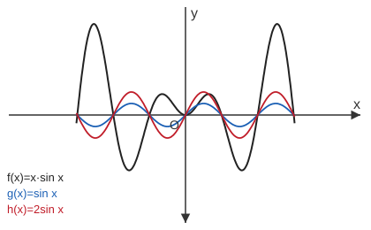

> 图像特征：$f(x)=x\sin x$ 的振幅随 $|x|$ 增大而增大（无界但非无穷大）；$g(x)=\sin x$ 与 $h(x)=2\sin x$ 均为有界振荡。

### 📝 例题 10

**【题目】**：$f(x)=x\sin x$ 是（ ）

- (A) 当 $x\to\infty$ 时为无穷大
- (B) 在 $(-\infty,+\infty)$ 内有界
- (C) 在 $(-\infty,+\infty)$ 内无界
- (D) 当 $x\to\infty$ 时有有限极限

**【解析】**：结合图像 $f(x)=x\sin x$：
令 $x_n=2n\pi+\dfrac{\pi}{2}$，当 $n\to\infty$ 时，$x_n\to\infty$，$f(x_n)=2n\pi+\dfrac{\pi}{2}\to+\infty$；
令 $y_n=2n\pi$，当 $n\to\infty$ 时，$y_n\to+\infty$，$f(y_n)=0$。
故 $f(x)$ **无界**（但非无穷大），选 (C)。

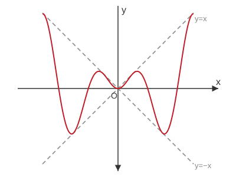

> 图像特征：振荡曲线被两条虚线（包络线 $y=\pm x$）夹住，波峰落在 $y=x$ 上，波谷落在 $y=-x$ 上，过原点。

---

# 第06节 等价无穷小、四则运算和洛必达法则

> 📌 **[说明]**：原图标题为「第六节 等价无穷小，四则运算和洛必达法则」，本文件编号与原图一致。

## 1. 无穷小量的阶

### （1）定义

设 $\lim\limits_{x\to x_0}\alpha(x)=0$，$\lim\limits_{x\to x_0}\beta(x)=0$

> 💡 **[旁注]**：加相同变化（位置：原图该行右侧，红字；指对 $\alpha(x)$、$\beta(x)$ 作相同的变形）

$$\lim_{x\to x_0}\frac{\alpha(x)}{\beta(x)}=
\begin{cases}
0, & \text{称 }\alpha(x)\text{ 是 }\beta(x)\text{ 的}\textbf{高阶无穷小}\text{，记为 }\alpha(x)=o(\beta(x))\\[6pt]
\infty, & \text{称 }\alpha(x)\text{ 是 }\beta(x)\text{ 的}\textbf{低阶无穷小}\text{，记为 }\alpha(x)=O(\beta(x))\\[6pt]
C\neq 0, & \text{称 }\alpha(x)\text{ 是 }\beta(x)\text{ 的}\textbf{同阶无穷小}\\[6pt]
1, & \text{称 }\alpha(x)\text{ 是 }\beta(x)\text{ 的}\textbf{等价无穷小}\text{，记为 }\alpha(x)\sim\beta(x)
\end{cases}$$

> ⚠️ **[智能体A注]**：记号 $\alpha=O(\beta)$ 通常表示 $\left|\alpha/\beta\right|$ 有界，用以表示“低阶”并不规范；低阶更常见的写法是 $\beta=o(\alpha)$（或 $\alpha=\omega(\beta)$）。此处按原笔记保留，仅作记号提醒。

### （2）k 阶无穷小

$$\lim_{x\to x_0}\frac{\alpha(x)}{\beta^k(x)}=C\neq 0,\quad\text{称 }\alpha(x)\text{ 是 }\beta(x)\text{ 的 }k\text{ 阶无穷小}$$

> 📌 **[知识点]**（原图红字、带下划线，位于本节下方）：注 2　无穷小量的阶描述了表达式趋于零的速度。

## 2. 等价无穷小（当 $x\to 0$ 时）

**（1）**

$$\sin x\sim\tan x\sim\arcsin x\sim\arctan x\sim x$$

$$1-\cos x\sim\frac12x^2,\qquad x-\sin x\sim\frac16x^3,\qquad \tan x-x\sim\frac13x^3,\qquad \tan x-\sin x\sim\frac12x^3$$

**（2）**

$$e^x-1\sim x,\qquad a^x-1=e^{x\ln a}-1\sim x\ln a$$

**（3）**

$$\ln(1+x)\sim x,\qquad x-\ln(1+x)\sim\frac12x^2$$

**（4）**

$$(1+x)^\alpha-1\sim\alpha x$$

**原图下方三条推导（验证上述等价）：**

**（i）**　换元：令 $t=e^x-1$，则 $x=\ln(1+t)$，

$$\lim_{x\to0}\frac{e^x-1}{x}=\lim_{t\to0}\frac{t}{\ln(1+t)}=\lim_{t\to0}\frac{1}{\ln(1+t)^{1/t}}=\frac{1}{\ln e}=1$$

**（ii）**

$$\lim_{x\to0}\frac{\ln(1+x)}{x}=\lim_{x\to0}\frac1x\ln(1+x)=\lim_{x\to0}\ln(1+x)^{\frac1x}=\ln e=1$$

**（iii）**

$$\lim_{x\to0}\frac{(1+x)^\alpha-1}{\alpha x}=\lim_{x\to0}\frac{e^{\alpha\ln(1+x)}-1}{\alpha x}=\lim_{x\to0}\frac{\alpha\ln(1+x)}{\alpha x}=\lim_{x\to0}\frac{\alpha x}{\alpha x}=1$$

### 📝 例题 1

**【题目】**：当 $x\to 0^+$ 时，与 $\sqrt x$ 等价的无穷小量是（　）．（原图勾选笔误，按 **(B)** 定稿）

- (A) $1-e^{\sqrt x}$
- (B) $\ln\dfrac{1+x}{1-\sqrt x}$
- (C) $\sqrt{1+\sqrt x}-1$
- (D) $1-\cos\sqrt x$

**【解析】**：由题设，当 $x\to 0^+$ 时

- (A) $1-e^{\sqrt x}=-(e^{\sqrt x}-1)\sim-\sqrt x$
- (B) $\ln\dfrac{1+x}{1-\sqrt x}=\ln\!\left(1+\dfrac{x+\sqrt x}{1-\sqrt x}\right)\sim\dfrac{x+\sqrt x}{1-\sqrt x}\sim x+\sqrt x\sim\sqrt x$
- (C) $\sqrt{1+\sqrt x}-1\sim\dfrac12\sqrt x$
- (D) $1-\cos\sqrt x\sim\dfrac12(\sqrt x)^2=\dfrac12x$

故与 $\sqrt x$ 等价的无穷小量是 **(B)**．

### 📝 例题 2

**【题目】**：设当 $x\to0$ 时，$e^{\tan x}-e^x$ 与 $x^n$ 是同阶无穷小，则 $n$ 为（　）．

- (A) 1
- (B) 2
- (C) 3
- (D) 4

> 📌 **[知识点]**（原图红字，位于题目下方）：提差套 $e^a-e^b=e^b\left(e^{a-b}-1\right)$

**【解析】**：由题设

$$\lim_{x\to0}\frac{e^{\tan x}-e^x}{x^n}=\lim_{x\to0}\frac{e^x\left(e^{\tan x-x}-1\right)}{x^n}=\lim_{x\to0}\frac{e^x(\tan x-x)}{x^n}=\lim_{x\to0}\frac{e^x\cdot\frac13x^3}{x^n}=\lim_{x\to0}\frac{\frac13x^3}{x^n}=C\neq0$$

故 $n=3$，选 **(C)**．

## 3. 高阶无穷小阶的运算

**（1）** $x^n\cdot o(x^m)=o(x^{n+m})$

$$\lim_{x\to0}\frac{x^n\cdot o(x^m)}{x^{n+m}}=\lim_{x\to0}\frac{o(x^m)}{x^m}=0$$

**（2）** $o(x^n)\cdot o(x^m)=o(x^{n+m})$

$$\lim_{x\to0}\frac{o(x^n)\,o(x^m)}{x^{n+m}}=\lim_{x\to0}\frac{o(x^n)}{x^n}\cdot\frac{o(x^m)}{x^m}=0\cdot0=0$$

**（3）** $o(x^n)-o(x^n)=o(x^n)$

**（4）** $o(x^m)+o(x^n)=o(x^n)\quad(m>n)$

> 📌 **[知识点]**（原图红字，位于（3）右侧）：无穷小量同阶运算无系数。

> 📌 **[知识点]**（原图红字，位于本节下方）：注　高阶无穷小量同阶运算，无系数，无正负号。

### 📝 例题 3

**【题目】**：当 $x\to0$ 时，用 $o(x^n)$ 表示比 $x^n$ 高阶的无穷小量，则下列式子中**错误**的是（　）．

- (A) $x\cdot o(x^2)=o(x^3)$
- (B) $o(x)\cdot o(x^2)=o(x^3)$
- (C) $o(x^2)+o(x^2)=o(x^2)$
- (D) $o(x)+o(x^2)=o(x^2)$

**【解析】**：由题设

- (A) $\lim\limits_{x\to0}\dfrac{x\cdot o(x^2)}{x^3}=\lim\limits_{x\to0}\dfrac{o(x^2)}{x^2}=0\ \Rightarrow\ x\cdot o(x^2)=o(x^3)$

- (B) $\lim\limits_{x\to0}\dfrac{o(x)\,o(x^2)}{x^3}=\lim\limits_{x\to0}\dfrac{o(x)}{x}\cdot\dfrac{o(x^2)}{x^2}=0\cdot0=0\ \Rightarrow\ o(x)\,o(x^2)=o(x^3)$

- (C) $\lim\limits_{x\to0}\dfrac{o(x^2)+o(x^2)}{x^2}=\lim\limits_{x\to0}\dfrac{o(x^2)}{x^2}+\dfrac{o(x^2)}{x^2}=0+0=0\ \Rightarrow\ o(x^2)+o(x^2)=o(x^2)$

- (D) $\lim\limits_{x\to0}\dfrac{o(x)+o(x^2)}{x^2}=\lim\limits_{x\to0}\dfrac{o(x)}{x^2}$ 不一定为 $0$（低阶项 $o(x)$ 主导，实为 $o(x)+o(x^2)=o(x)\neq o(x^2)$）

故错误的为 **(D)**（原图末尾标注「∴ 选 D」）．

> ⚠️ **[智能体A注]**：原笔记 (D) 推导不完整。补反例：取 $f(x)=x^{3/2}=o(x)$、$g(x)=0=o(x^2)$，则 $\dfrac{f+g}{x^2}=x^{-1/2}\to\infty$，故 $o(x)+o(x^2)\neq o(x^2)$，(D) 不成立。

## 4. 极限四则运算

> 💡 **[旁注]**：加减乘除（位置：标题右侧，红字）

设 $\lim f(x)=A$，$\lim g(x)=B$，则

**（1）** $\lim[f(x)\pm g(x)]=\lim f(x)\pm\lim g(x)=A\pm B$

**（2）** $\lim[f(x)\cdot g(x)]=\lim f(x)\cdot\lim g(x)=A\cdot B$

**（3）** $\lim\dfrac{f(x)}{g(x)}=\dfrac{\lim f(x)}{\lim g(x)}=\dfrac{A}{B}\quad(B\neq0)$

> 📌 **[知识点]**（原图红字，位于本节下方）：注　极限都存在、分母不为 $0$，才可以拆开计算。

## 5. 等价无穷小替换定理

设 $\lim\limits_{x\to x_0}\alpha(x)=0$，$\lim\limits_{x\to x_0}\beta(x)=0$，且 $\alpha(x)\sim\tilde\alpha(x)$，$\beta(x)\sim\tilde\beta(x)$，则

$$\lim_{x\to x_0}\frac{\alpha(x)}{\beta(x)}=\lim_{x\to x_0}\frac{\tilde\alpha(x)}{\tilde\beta(x)}=\lim_{x\to x_0}\frac{\alpha(x)}{\tilde\beta(x)}=\lim_{x\to x_0}\frac{\tilde\alpha(x)}{\beta(x)}$$

> 📌 **[知识点]**（原图红字，位于本节下方）：注 2　加减法慎用等价无穷小，乘除法（整体）可用；局部不可用等价，函数内部不可用等价。

### 📝 例题 4

**【题目】**：$\lim\limits_{n\to\infty}\dfrac{\dfrac1n-\sin\dfrac1n}{\sin^3\dfrac1n}$

> 💡 **[旁注]**：数列极限，连续化后用等价无穷小（位置：题目右上，红框；原图标注“洛必达”，实际求解未用到）

**【解析】**：

$$\text{原式}=\lim_{n\to\infty}\frac{\dfrac1n-\sin\dfrac1n}{\sin^3\dfrac1n}=\lim_{n\to\infty}\frac{\dfrac16\cdot\dfrac1{n^3}}{\dfrac1{n^3}}=\frac16$$

（分母 $\sin^3\dfrac1n\sim\dfrac1{n^3}$，与分子 $\dfrac1n-\sin\dfrac1n\sim\dfrac1{6n^3}$ 同阶，故原式 $=\dfrac16$，原笔记正确。）

### 📝 例题 5

**【题目】**：$\lim\limits_{x\to0}\dfrac{e-e^{\cos x}}{\sqrt[3]{1+x^2}-1}$

> 📌 **[知识点]**（原图红字，位于题目右上）：×局部等价——上面被划掉的做法是错的（反面例子）。

**【解析】**：

$$\text{原式}=\lim_{x\to0}\frac{e\left(1-e^{\cos x-1}\right)}{\frac13x^2}=\lim_{x\to0}\frac{-(e^{\cos x-1}-1)\,e}{\frac13x^2}=\lim_{x\to0}\frac{(1-\cos x)\,e}{\frac13x^2}=\lim_{x\to0}\frac{\frac12x^2\,e}{\frac13x^2}=\frac32e$$

（原图答案框：$\dfrac32e$）

### 📝 例题 6

**【题目】**：求极限 $\lim\limits_{x\to1}\dfrac{x^x-1}{x\ln x}$

**【解析】**：由题设

$$\text{原式}=\lim_{x\to1}\frac{e^{x\ln x}-1}{x\ln x}=\lim_{x\to1}\frac{x\ln x}{x\ln x}=1$$

### 📝 例题 7

**【题目】**：$\lim\limits_{x\to0}\dfrac{3\sin x+x^2\cos\dfrac1x}{(1+\cos x)\ln(1+x)}$

**【解析】**：由题设

$$\text{原式}=\lim_{x\to0}\frac{1}{1+\cos x}\cdot\frac{3\sin x+x^2\cos\frac1x}{\ln(1+x)}=\frac12\cdot\lim_{x\to0}\frac{3\sin x+x^2\cos\frac1x}{x}$$

$$=\lim_{x\to0}\frac{3\sin x}{2x}+\lim_{x\to0}\frac{x\cos\frac1x}{2}=\frac32+\lim_{x\to0}\frac12x\cos\frac1x$$

> 📌 **[知识点]**（原图红字，位于该行下方）：无穷小 $\times$ 有界 $=$ 无穷小。

$$=\frac32+0=\frac32$$

### 📝 例题 8

**【题目】**：求 $\lim\limits_{x\to0}\dfrac{1-\cos x}{x\left(1-\cos\sqrt x\right)}$

**【解析】**：由题设

$$\text{原式}=\lim_{x\to0}\frac{1-\cos x}{x\left(1-\cos\sqrt x\right)}=\lim_{x\to0}\frac{\frac12x^2}{x\cdot\frac12\left(\sqrt x\right)^2}=\lim_{x\to0}\frac{\frac12x^2}{\frac12x^2}=1$$

> ⚠️ **[智能体A注]**：原笔记末值写作 $\frac12$，应为 **1**（$\frac{\frac12x^2}{\frac12x^2}=1$），系笔误。

### 📝 例题 9

**【题目】**：$\lim\limits_{x\to0}\dfrac{e^{x^2}-\cos x}{\ln(\cos x)}$

**【解析】**：由题设

$$\text{原式}=\lim_{x\to0}\frac{e^{x^2}-\cos x}{\ln\!\left(1+(\cos x-1)\right)}=\lim_{x\to0}\frac{e^{x^2}-\cos x}{\cos x-1}=\lim_{x\to0}\frac{\left(e^{x^2}-1\right)+(1-\cos x)}{\cos x-1}$$

$$=\lim_{x\to0}\frac{e^{x^2}-1}{\cos x-1}+\lim_{x\to0}\frac{1-\cos x}{\cos x-1}=-2+(-1)=-3$$

### 📝 例题 10

**【题目】**：$\lim\limits_{x\to0}\left(\dfrac{1}{\sin^2x}-\dfrac{1}{x^2}\right)$

**【解析】**：由题设

$$\text{原式}=\lim_{x\to0}\frac{x^2-\sin^2x}{x^2\sin^2x}=\lim_{x\to0}\frac{(x-\sin x)(x+\sin x)}{x^4}=\lim_{x\to0}\left(1+\frac{\sin x}{x}\right)\cdot\lim_{x\to0}\frac{x-\sin x}{x^3}$$

$$=(1+1)\cdot\lim_{x\to0}\frac{x-\sin x}{x^3}=2\cdot\frac16=\frac13$$

### 📝 例题 11

**【题目】**：$\lim\limits_{x\to+\infty}\dfrac{e^x}{\left(1+\dfrac1x\right)^{x^2}}$

**【解析】**：

$$\text{原式}=\lim_{x\to\infty}\frac{e^x}{e^{x^2\ln\left(1+\frac1x\right)}}=\lim_{x\to\infty}e^{\,x-x^2\ln\left(1+\frac1x\right)}$$

令 $\dfrac1x=t$，则

$$\text{原式}=\lim_{t\to0^+}e^{\frac1t-\frac{\ln(1+t)}{t^2}}=\lim_{t\to0^+}e^{\frac{t-\ln(1+t)}{t^2}}=\lim_{t\to0^+}e^{\frac{\,t^2/2\,}{t^2}}=\lim_{t\to0^+}e^{\frac12}=e^{\frac12}=\sqrt e$$

## 6. 洛必达法则

> 💡 **[旁注]**：先定型 → 再求导（位置：标题右侧，红字）

$$\lim_{x\to x_0}\frac{f(x)}{g(x)}\ \overset{\frac{0}{0}\,/\,\frac{\infty}{\infty}}{=}\ \lim_{x\to x_0}\frac{f'(x)}{g'(x)}\ \overset{\frac{0}{0}\,/\,\frac{\infty}{\infty}}{=}\ \lim_{x\to x_0}\frac{f''(x)}{g''(x)}$$

> 📌 **[知识点]**（原图红字，位于公式下方）：存在 $\Leftarrow$ 存在；不存在 $\nRightarrow$ 不存在（第二条箭头带划叉）。

### 📝 例题 12

**【题目】**：求极限 $\lim\limits_{x\to1}\dfrac{\ln\left(\cos(x-1)\right)}{1-\sin\dfrac{\pi x}{2}}$

**【解析】**（方法一：洛必达 + 等价）

$$\text{原式}\ \overset{\text{洛必达}}{=}\ \lim_{x\to1}\frac{-\tan(x-1)}{-\dfrac{\pi}{2}\cos\dfrac{\pi x}{2}}=\lim_{x\to1}\frac{2}{\pi}\cdot\frac{\tan(x-1)}{\cos\dfrac{\pi x}{2}}$$

其中 $\tan(x-1)\sim(x-1)$，$\cos\dfrac{\pi x}{2}=-\sin\dfrac{\pi(x-1)}{2}\sim-\dfrac{\pi(x-1)}{2}$，故

$$\text{原式}=\frac{2}{\pi}\cdot\left(-\frac{2}{\pi}\right)=-\frac{4}{\pi^2}$$

**【解析】**（方法二：换元 $x-1=t$）

$$\lim_{t\to0}\frac{\ln\cos t}{1-\sin\dfrac{\pi(1+t)}{2}}=\lim_{t\to0}\frac{\ln\cos t}{1-\cos\dfrac{\pi t}{2}}=\lim_{t\to0}\frac{-\frac12t^2}{\frac12\left(\frac{\pi t}{2}\right)^2}=-\frac{4}{\pi^2}$$

> ⚠️ **[智能体A注]**：原笔记方法一末值写作 $-\dfrac{2}{\pi}$，为中途笔误；两法结果应一致，均为 $-\dfrac{4}{\pi^2}$。

### 📝 例题 13

**【题目】**：$\lim\limits_{x\to\infty}\dfrac{x+\sin x}{x-\sin x}$

**【解析】**：

若用洛必达：

$$\lim_{x\to\infty}\frac{1+\cos x}{1-\cos x}\quad(\text{原图红字：不存在})$$

即洛必达法则在此失效（导数之比的极限不存在），应改用其他方法：

$$\text{原式}=\lim_{x\to\infty}\frac{1+\dfrac{\sin x}{x}}{1-\dfrac{\sin x}{x}}=\frac{1+0}{1-0}=1$$

---

# 第07节 泰勒公式、左右极限和极限反问题

## 1. 泰勒公式

$$
\begin{aligned}
e^x=1+x+\frac{1}{2!}x^2+\frac{1}{3!}x^3+\cdots+\frac{1}{n!}x^n+\cdots \\
=1+x+\frac{1}{2!}x^2+\frac{1}{3!}x^3+\cdots+\frac{1}{n!}x^n+o(x^n)
\end{aligned}
$$

> 📌 **[知识点]**（蓝字，位于该行右侧）：皮亚诺型余项

$$
\begin{aligned}
\sin x=x-\frac{1}{3!}x^3+\frac{1}{5!}x^5+\cdots+\frac{(-1)^n}{(2n+1)!}x^{2n+1}+o\left(x^{2n+2}\right) \\
=x-\frac{1}{3!}x^3+\frac{1}{5!}x^5+\cdots+\frac{(-1)^n}{(2n+1)!}x^{2n+1}+0\cdot x^{2n+2}+o\left(x^{2n+2}\right)
\end{aligned}
$$

$$
\begin{aligned}
\cos x=1-\frac{1}{2!}x^2+\frac{1}{4!}x^4+\cdots+\frac{(-1)^n}{(2n)!}x^{2n}+o\left(x^{2n+1}\right) \\
=1-\frac{1}{2!}x^2+\frac{1}{4!}x^4+\cdots+\frac{(-1)^n}{(2n)!}x^{2n}+0\cdot x^{2n+1}+o\left(x^{2n+1}\right)
\end{aligned}
$$

> 💡 **[旁注]**：「奇」为红字，位于 $\sin x$ 行上方；「偶」为红字，位于 $\cos x$ 行上方；蓝色「缺」字带弯箭头由 $\sin x$ 指向 $\cos x$（位置：原图左边缘）。含义：$\sin x$ 只含奇次项（奇函数）、$\cos x$ 只含偶次项（偶函数），二者互为缺项，故展开时可用 $0\cdot x^{k}$ 补位。

$$
\ln(1+x)=x-\frac12x^2+\frac13x^3+\cdots+\frac{(-1)^n}{n+1}x^{n+1}+o\left(x^{n+1}\right)
$$

$$
(1+x)^{\alpha}=1+\alpha x+\frac{\alpha(\alpha-1)}{2!}x^2+\cdots+\frac{\alpha(\alpha-1)\cdots(\alpha-n+1)}{n!}x^n+o(x^n)
$$

> 📌 **[知识点]**（原图红字 [注]，位于展开式下方）：
> （1）分子分母同阶原则；
> （2）系数不为零原则。

### 📝 例题 1

**【题目】**：$\lim\limits_{x\to0}\dfrac{e^{x^3}-1-x^3}{\sin^6x}$

**【解析】**：由题设（$\sin^6x\sim x^6$）

$$
\text{原式}=\lim_{x\to0}\frac{e^{x^3}-1-x^3}{x^6}=\lim_{x\to0}\frac{\left(1+x^3+\frac{1}{2!}x^6-1-x^3+o(x^6)\right)}{x^6}=\lim_{x\to0}\frac{\frac{1}{2!}x^6+o(x^6)}{x^6}=\frac12
$$

> 📌 **[知识点]**（原图红字 [注2]，位于本页页末）：泰勒公式要带皮亚诺余项。

### 📝 例题 2

**【题目】**：$\lim\limits_{x\to0}\dfrac{\cos x-e^{-\frac{x^2}{2}}}{x^2\left(x+\ln(1-x)\right)}$

> 📌 **[知识点]**（原图红字，位于题目右侧页边）：
>
> $$
> \ln(1+x)=x-\frac12x^2+o(x^3)\ \Rightarrow\ \ln(1-x)=-x-\frac12x^2+o(x^2)
> $$
>
> $$
> e^x=1+x+\frac{x^2}{2!}+o(x^2)\ \Rightarrow\ e^{-\frac{x^2}{2}}=1-\frac{x^2}{2}+\frac{x^4}{8}+o(x^4)
> $$

**【解析】**：由题设

$$
\begin{aligned}
\text{原式}=\lim_{x\to0}\frac{1-\frac{x^2}{2!}+\frac{x^4}{4!}+o(x^4)-\left(1-\frac{x^2}{2}+\frac{x^4}{8}+o(x^4)\right)}{x^2\left(x-x-\frac12x^2+o(x^2)\right)} \\
=\lim_{x\to0}\frac{-\frac{1}{12}x^4+o(x^4)}{-\frac12x^4+o(x^4)}=\lim_{x\to0}\frac{-\frac{1}{12}+\frac{o(x^4)}{x^4}}{-\frac12+\frac{o(x^4)}{x^4}}=-\frac{1}{12}\cdot(-2)=\frac16
\end{aligned}
$$

### 📝 例题 3

**【题目】**：$\lim\limits_{x\to0}\left(\dfrac{1}{\sin^2x}-\dfrac{\cos^2x}{x^2}\right)$

**【解析】**：由题设

$$
\begin{aligned}
\text{原式}=\lim_{x\to0}\frac{x^2-\sin^2x\cos^2x}{x^2\sin^2x}=\lim_{x\to0}\frac{x^2-\sin^2x\cos^2x}{x^4} \\
=\lim_{x\to0}\frac{x^2-\frac14\cdot\frac{1-\cos4x}{2}}{x^4}=\lim_{x\to0}\frac{x^2-\frac18\left(1-\cos4x\right)}{x^4} \\
=\lim_{x\to0}\frac{x^2-\frac18+\frac18\left(1-\frac12(4x)^2+\frac{1}{4!}(4x)^4+o(x^4)\right)}{x^4}=\lim_{x\to0}\frac{\frac43x^4+o(x^4)}{x^4}=\frac43
\end{aligned}
$$

> 📌 **[知识点]**（原图红字 [注2]，位于本页页末）：三角函数 → 先降幂，再计算（极限、求导、积分）。

## 2. 左右极限

> 💡 **[旁注]**：函数极限 → 曲线的变化趋势（位置：标题右侧，红字）

**定理**：

$$
\lim_{x\to x_0}f(x)=A\iff \lim_{x\to x_0^+}f(x)=\lim_{x\to x_0^-}f(x)=A
$$

> 📌 **[知识点]**（原图红字 [注]，位于定理下方）：
> （1）分段函数在分段点；
> （2）$\dfrac1x$，$\arctan\dfrac1x$，$e^{\frac1x}$；
> （3）当 $x\to\infty$ 时，包含 $x\to+\infty$ 和 $x\to-\infty$，即 $\infty=\pm\infty$（此条为蓝字）。

### 📝 例题 4

**【题目】**：$\lim\limits_{x\to0^+}\dfrac{1-e^{\frac1x}}{x+e^{\frac1x}}$

**【解析】**：

$$
\text{原式}=\lim_{x\to0^+}\frac{e^{-\frac1x}-1}{xe^{-\frac1x}+1}=\frac{0-1}{0+1}=-1
$$

> 📌 **[知识点]**（原图红字，位于本例下方）：函数极限 → 曲线变化（曲线趋势）。

### 📝 例题 5

**【题目】**：$\lim\limits_{x\to0}\left(\dfrac{2+e^{\frac1x}}{1+e^{\frac4x}}+\dfrac{\sin x}{|x|}\right)$

**【解析】**：由题设（左右极限分别计算）

$$
\lim_{x\to0^+}\left(\frac{2+e^{\frac1x}}{1+e^{\frac4x}}+\frac{\sin x}{|x|}\right)=0+1=1
$$

$$
\lim_{x\to0^-}\left(\frac{2+e^{\frac1x}}{1+e^{\frac4x}}+\frac{\sin x}{|x|}\right)=2-1=1
$$

左右极限相等，故原式 $=1$。

> 💡 **[旁注]**：$\dfrac{\sin x}{|x|}$ 分左右两侧讨论——右侧 $x\to0^+$ 时 $x>0$，$|x|=x$，故 $\dfrac{\sin x}{|x|}=\dfrac{\sin x}{x}\to1$；左侧 $x\to0^-$ 时 $x<0$，$|x|=-x$，故 $\dfrac{\sin x}{|x|}=-\dfrac{\sin x}{x}\to-1$。第一行写 $\dfrac{\sin x}{x}$（正、取 1），第二行结果为 $2-1=1$（负、取 $-1$），与此完全对应。分母指数经确认为 $e^{\frac4x}$。

## 3. 极限反问题

> 📌 **[知识点]**（蓝字，位于标题右侧）：已知极限，求表达式/参数。

**（1）** 若 $\lim\limits_{x\to x_0}\dfrac{f(x)}{g(x)}=A$，$\lim\limits_{x\to x_0}g(x)=0$，则 $\lim\limits_{x\to x_0}f(x)=0$。

**证明**：

$$
\lim_{x\to x_0}f(x)=\lim_{x\to x_0}\frac{f(x)}{g(x)}\cdot g(x)=A\cdot 0=0
$$

**（2）** 若 $\lim\limits_{x\to x_0}\dfrac{f(x)}{g(x)}=B\neq0$，$\lim\limits_{x\to x_0}f(x)=0$，则 $\lim\limits_{x\to x_0}g(x)=0$。

### 📝 例题 6

**【题目】**：已知当 $x\to0$ 时，$(1+ax^2)^{\frac13}-1$ 与 $\cos x-1$ 是等价无穷小，则常数 $a$ 为？

**【解析】**：由题设

$$
\lim_{x\to0}\frac{(1+ax^2)^{\frac13}-1}{\cos x-1}=\lim_{x\to0}\frac{\frac13ax^2}{-\frac12x^2}=-\frac23a=1
$$

故 $a=-\dfrac32$。

### 📝 例题 7

**【题目】**：已知 $\lim\limits_{x\to\infty}\left(\dfrac{x^2}{x+1}-ax-b\right)=0$，其中 $a,b$ 常数，则（　）

- (A) $a=1,\ b=1$
- (B) $a=-1,\ b=1$
- (C) $a=1,\ b=-1$
- (D) $a=-1,\ b=-1$

**【解析】**：由题设

$$
\text{原式}=\lim_{x\to\infty}\frac{x^2-(ax+b)(x+1)}{x+1}=\lim_{x\to\infty}\frac{(1-a)x^2-(a+b)x-b}{x+1}=0
$$

则

$$
\begin{cases}1-a=0\\ a+b=0\end{cases}\quad\text{解得}\quad\begin{cases}a=1\\ b=-1\end{cases}
$$

> 💡 **[旁注]**：原图解析止于「解得」，末尾未写选项字母；按计算结果应选 **(C)**。

### 📝 例题 8

**【题目】**：设函数 $f(x)$ 在 $x=0$ 的某邻域内具有一阶连续导数，且 $f(0)\neq0$，$f'(0)\neq0$，若 $af(h)+bf(2h)-f(0)$ 在 $h\to0$ 时是比 $h$ 高阶的无穷小，试确定 $a,b$ 的值。

**【解析】**：由题设

$$
\lim_{h\to0}\frac{af(h)+bf(2h)-f(0)}{h}=\lim_{h\to0}\frac{af'(h)+2bf'(2h)}{1}=0
$$

**（1）** $\lim\limits_{h\to0}\left[af(h)+bf(2h)-f(0)\right]=af(0)+bf(0)-f(0)=0$，

由于 $f(0)\neq0$，则 $a+b-1=0$。

**（2）** $\lim\limits_{h\to0}\left[af'(h)+2bf'(2h)\right]=af'(0)+2bf'(0)=0$，

由于 $f'(0)\neq0$，则 $a+2b=0$。

$$
\begin{cases}a+b-1=0\\ a+2b=0\end{cases}\quad\text{解得}\quad\begin{cases}a=2\\ b=-1\end{cases}
$$

### 📝 例题 9

**【题目】**：当 $x\to0$ 时，$e^x-(ax^2+bx+1)$ 是比 $x^2$ 高阶的无穷小，则（　）

- (A) $a=\dfrac12,\ b=1$
- (B) $a=1,\ b=1$
- (C) $a=-\dfrac12,\ b=1$
- (D) $a=-1,\ b=1$

**【解析】**：由题设

$$
\lim_{x\to0}\frac{e^x-(ax^2+bx+1)}{x^2}=\lim_{x\to0}\frac{1+x+\frac{x^2}{2!}+o(x^2)-(ax^2+bx+1)}{x^2}=\lim_{x\to0}\frac{\left(\frac12-a\right)x^2+(1-b)x+o(x^2)}{x^2}=0
$$

故

$$
\begin{cases}\frac12-a=0\\ 1-b=0\end{cases}\quad\text{解得}\quad\begin{cases}a=\frac12\\ b=1\end{cases}
$$

选 **(A)**。

---

# 第08节 连续和间断

> 📌 **[说明]**：原图标题为「第08节 连续和间断」，本文件编号与原图一致。

## 1. 函数在某点处的连续

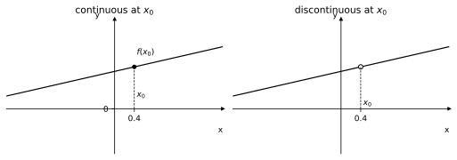

> 图像特征：左图曲线在 $x=x_0$ 处连续，极限值等于函数值；右图在 $x=x_0$ 处断开（空心点），说明极限与函数值彼此无关，是连续性的反例。

设 $f(x)$ 在 $U_\delta(x_0)$ 内有定义

$$\lim_{x\to x_0}f(x)=f(x_0)$$

称 $f(x)$ 在 $x=x_0$ 处连续。

> 📌 **[知识点]**（原图红字 [注]）：
> （1）$\lim\limits_{x\to x_0}f(x)$ 存在；
> （2）$f(x_0)$ 有定义；
> （3）$\lim\limits_{x\to x_0}f(x)=f(x_0)$。

> 📌 **[知识点]**（原图蓝字 [定理]）：
> $$\lim_{x\to x_0}f(x)=f(x_0)\iff \lim_{x\to x_0^-}f(x)=\lim_{x\to x_0^+}f(x)=f(x_0)$$
> 连续的必要条件：左、右极限与函数值相等。

> 📌 **[知识点]**（原图红字 [注2]）：特殊点 $\to$ 分段点、无定义点。

### 📝 例题 1

**【题目】**：讨论函数 $f(x)=\begin{cases}\sqrt{|x|}\sin\dfrac1x,& x\neq 0\\[6pt] 0,& x=0\end{cases}$ 在点 $x=0$ 处的连续性。

**【解析】**：由题设，$f(x)$ 在 $x=0$ 两侧表达式相同。

$$\lim_{x\to0}f(x)=\lim_{x\to0}|x|^{\frac12}\sin\frac1x=0=f(0)$$

故 $f(x)$ 在 $x=0$ 处连续。

### 📝 例题 2

**【题目】**：设函数 $f(x)=\begin{cases}\dfrac{1-e^{\tan x}}{\arcsin\dfrac{x}{2}},& x>0\\[10pt] ae^{2x},& x\leq 0\end{cases}$ 在 $x=0$ 处连续，则 $a=$ ____。

**【解析】**：由题设，$f(x)$ 在 $x=0$ 两侧表达式不同。

$$\lim_{x\to0^-}f(x)=\lim_{x\to0^-}ae^{2x}=a,\qquad f(0)=a$$

$$\lim_{x\to0^+}f(x)=\lim_{x\to0^+}\frac{1-e^{\tan x}}{\arcsin\dfrac{x}{2}}=\lim_{x\to0^+}\frac{-x}{\dfrac{x}{2}}=-2$$

当 $a=-2$ 时，$f(x)$ 在 $x=0$ 处连续。

> 📌 **[说明]**：原图此处紧接第 1 部分，未另写小节标题；以下 (1)(2) 按原图编号保留。

### （1）

任意 $x_0\in(a,b)$，$f(x)$ 在 $x=x_0$ 处连续，称 $f(x)$ 在 $(a,b)$ 连续。

### （2）

任意 $x_0\in(a,b)$，$f(x)$ 在 $x=x_0$ 处连续，且

$$\lim_{x\to a^+}f(x)=f(a),\qquad \lim_{x\to b^-}f(x)=f(b)$$

称 $f(x)$ 在 $[a,b]$ 连续。

> 📌 **[知识点]**（原图红字 [注2]，右侧配两个小箭头示意）：
> $\lim\limits_{x\to x_0^-}f(x)=f(x_0)$，称 $f(x)$ 在 $x=x_0$ 处**左连续**；
> $\lim\limits_{x\to x_0^+}f(x)=f(x_0)$，称 $f(x)$ 在 $x=x_0$ 处**右连续**。

## 2. 间断点

> 📌 **[知识点]**（原图蓝字，位于标题右侧）：（不连续点）$\lim\limits_{x\to x_0}f(x)\neq f(x_0)$

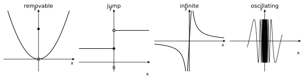

> 图像特征：从左至右依次为——可去（曲线有空洞，另有点补出）、跳跃（左右两段高度不同）、无穷（$x\to x_0$ 时函数值趋于 $\pm\infty$，有竖直渐近线）、振荡（曲线在 $x_0$ 附近无限密集振荡）。

### （1）第一类间断点

$\lim\limits_{x\to x_0^-}f(x)$ 和 $\lim\limits_{x\to x_0^+}f(x)$ 都存在。

- 若 $\lim\limits_{x\to x_0^-}f(x)=\lim\limits_{x\to x_0^+}f(x)$，称 $x_0$ 为**可去间断点**。

  $f(x)=\dfrac{\sin x}{x}\ (x\neq 0)$

  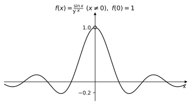

  > 图像特征：曲线在 $x=0$ 处有空洞，极限为 1；补定义 $f(0)=1$ 后即连续。

  故补充定义后

  $$f(x)=\begin{cases}\dfrac{\sin x}{x},& x\neq 0\\[6pt] 1,& x=0\end{cases}$$

  $f(x)$ 在 $x=0$ 连续。

- 若 $\lim\limits_{x\to x_0^-}f(x)\neq\lim\limits_{x\to x_0^+}f(x)$，称 $x_0$ 为**跳跃间断点**。

  $g(x)=[x]$

  ![图4：取整函数 $y=[x]$ 的阶梯图](images/s08-fig4-floor.svg)

  > 图像特征：每两个相邻整数之间为水平线段，左端空心、右端实心；在每个整数点处左右极限相差 1，均为跳跃间断点。

### （2）第二类间断点

$\lim\limits_{x\to x_0^-}f(x)$ 和 $\lim\limits_{x\to x_0^+}f(x)$ 至少有一个不存在。

- $\lim\limits_{x\to x_0^-}f(x)=\infty$ 或 $\lim\limits_{x\to x_0^+}f(x)=\infty$，称 $x_0$ 为**无穷间断点**。

  $h(x)=\dfrac1x\ (x\neq 0)$

  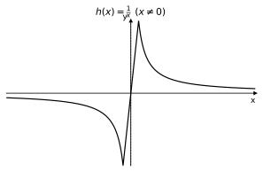

  > 图像特征：$x\to0^\pm$ 时函数值分别趋于 $\mp\infty$，$y$ 轴为竖直渐近线。

- $\lim\limits_{x\to x_0}\sin\dfrac1x$ 振荡，称 $x_0=0$ 是**振荡间断点**。

  $R(x)=\sin\dfrac1x\ (x\neq 0)$

  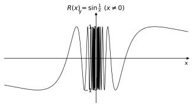

  > 图像特征：$x\to0$ 时曲线在 $[-1,1]$ 内无限次振荡，极限不存在。

> 📌 **[知识点]**（原图红字 [注]）：
> （1）分母为零或定义不明的点 $\to$ 间断点；
> （2）由 $\lim\limits_{x\to x_0^-}f(x)$、$\lim\limits_{x\to x_0^+}f(x)$ $\to$ 判断间断点类型。

### 📝 例题 3

**【题目】**：求函数 $f(x)=\dfrac{x^2-2x}{|x|(x^2-4)}$ 的间断点，并确定其类型。

**【解析】**：由题设，$x=0,\ x=2,\ x=-2$ 是间断点。

（1）当 $x=0$ 时，

$$f(0-0)=\lim_{x\to0^-}\frac{x(x-2)}{|x|(x-2)(x+2)}=-\frac12$$

$$f(0+0)=\lim_{x\to0^+}\frac{x(x-2)}{|x|(x-2)(x+2)}=\frac12$$

> 💡 **[旁注]**：跳跃间断点（位置：原图该段左侧，红字）。

（2）当 $x=2$ 时，

$$f(2-0)=\lim_{x\to2^-}\frac{x(x-2)}{|x|(x-2)(x+2)}=\frac14$$

$$f(2+0)=\lim_{x\to2^+}\frac{x(x-2)}{|x|(x-2)(x+2)}=\frac14$$

> 💡 **[旁注]**：可去间断点（位置：原图该段左侧，红字）。

（3）当 $x=-2$ 时，

$$f(-2-0)=\lim_{x\to-2^-}\frac{x(x-2)}{|x|(x-2)(x+2)}=+\infty$$

$$f(-2+0)=\lim_{x\to-2^+}\frac{x(x-2)}{|x|(x-2)(x+2)}=\infty$$

> 💡 **[旁注]**：无穷间断点（位置：原图该段左侧，红字）。

> ⚠️ **[智能体A注]**：原笔记第二行只写作 $\infty$；严格说 $x\to-2^+$ 时 $x+2>0$、$x/|x|=-1$，应为 $-\infty$。结论（无穷间断点）不受影响。

### 📝 例题 4

**【题目】**：函数 $f(x)=\dfrac{x-x^3}{\sin\pi x}$ 的可去间断点。

**【解析】**：由题设，$x=0,\ x=\pm1,\ \pm2,\ \cdots$ 是间断点。

（1）$\lim\limits_{x\to0}f(x)=\lim\limits_{x\to0}\dfrac{x(1-x^2)}{\sin\pi x}=\lim\limits_{x\to0}\dfrac{x(1-x^2)}{\pi x}=\dfrac1\pi$，$x=0$ 可去间断点。

（2）$\lim\limits_{x\to1}f(x)=\lim\limits_{x\to1}\dfrac{x-x^3}{\sin\pi x}=\lim\limits_{x\to1}\dfrac{1-3x^2}{\pi\cos\pi x}=\dfrac2\pi$，$x=1$ 可去间断点。

（3）$\lim\limits_{x\to-1}f(x)=\lim\limits_{x\to-1}\dfrac{x-x^3}{\sin\pi x}=\lim\limits_{x\to-1}\dfrac{1-3x^2}{\pi\cos\pi x}=\dfrac2\pi$，$x=-1$ 可去间断点。

（4）当 $x=\pm2,\ \pm3,\ \cdots$ 是无穷间断点。

### 📝 例题 5

**【题目】**：设函数 $f(x)=\lim\limits_{n\to\infty}\dfrac{1+x}{1+x^{2n}}$，讨论函数 $f(x)$ 的间断点，其结论为（ ）

- (A) 不存在间断点
- (B) 存在间断点 $x=1$
- (C) 存在间断点 $x=0$
- (D) 存在间断点 $x=-1$

> 💡 **[旁注]**（蓝字，位于题干下方）：$f(x)=\lim\limits_{n\to\infty}g(x,n)=g(x,\infty)$ —— 先固定 $x$，再取极限（$n\to\infty$）。

**【解析】**：由题设

$$f\!\left(\frac12\right)=\lim_{n\to\infty}\frac{1+\frac12}{1+\left(\frac12\right)^{2n}}=1+\frac12;\qquad f(2)=\lim_{n\to\infty}\frac{1+2}{1+2^{2n}}=0$$

当 $|x|<1$ 时，$f(x)=\lim\limits_{n\to\infty}\dfrac{1+x}{1+x^{2n}}=1+x$；

当 $x=1$ 时，$f(1)=\lim\limits_{n\to\infty}\dfrac{1+1}{1+1}=1$；

当 $x=-1$ 时，$f(-1)=\lim\limits_{n\to\infty}\dfrac{1+(-1)}{1+1}=0$；

当 $|x|>1$ 时，$f(x)=\lim\limits_{n\to\infty}\dfrac{1+x}{1+x^{2n}}=0$。

$$\therefore\ f(x)=\begin{cases}1+x,&|x|<1\\[4pt] 1,& x=1\\[4pt] 0,& x=-1\ \text{或}\ |x|>1\end{cases}$$

> 📌 **[知识点]**（原图红字 [注]）：
> $$\lim_{n\to\infty}x^{2n}=\begin{cases}0,&|x|<1\\[4pt] 1,&|x|=1\\[4pt] +\infty,&|x|>1\end{cases}$$

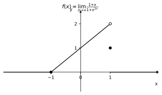

> 图像特征：$(-1,1)$ 上为直线 $y=1+x$；$x=1$ 处左极限为 2（空心点）、函数值为 1（实心点）；$|x|>1$ 时恒为 0。$x=-1$ 处左右极限与函数值同为 0，连续。

> 💡 **[旁注]**（蓝字，位于图右侧）：$x=1$ 是跳跃间断点。

故 $f(x)$ 仅在 $x=1$ 处间断，选 **(B)**。

## 5. 有界闭区间连续函数的性质

> 📌 **[说明]**：原图小节编号为 1、2、5（缺 3、4），此处照原编号保留。

> 💡 **[旁注]**（蓝字，位于标题右侧）：有界闭区间 $\to [a,b]$

设 $f(x)$ 在 $[a,b]$ 连续，则

### （1）最值定理

有界闭区间上的连续函数 $f(x)$，有最大值 $M$ 和最小值 $m$

$$f(x_0)=M,\quad x_0\in[a,b];\qquad f(x_1)=m,\quad x_1\in[a,b]$$

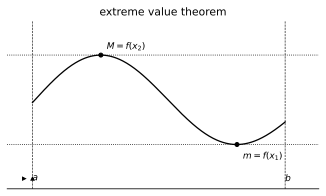

> 图像特征：曲线在 $[a,b]$ 上连续，最高点取到最大值 $M$，最低点取到最小值 $m$（虚线标出）。

### （2）有界定理

有界闭区间上连续函数 $f(x)$ 必有界（$m\leq f(x)\leq M$）。

### （3）零点定理

有界闭区间上连续函数 $f(x)$，满足 $f(a)\cdot f(b)<0$，则存在 $\xi\in(a,b)$ 使得 $f(\xi)=0$。

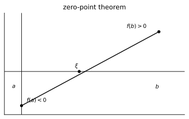

> 图像特征：曲线由 $x=a$ 处的负值连续变到 $x=b$ 处的正值，必在 $(a,b)$ 内穿过 $x$ 轴，交点横坐标为 $\xi$。

### （4）介值定理

有界闭区间 $[a,b]$ 上的连续函数 $f(x)$ 有最大值 $M$ 和最小值 $m$，且 $m\leq C\leq M$，则存在 $\xi$ 使 $f(\xi)=C$（$a\leq\xi\leq b$）。

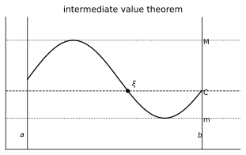

> 图像特征：水平线 $y=C$ 位于 $m$ 与 $M$ 之间，与连续曲线必有交点 $(\xi,C)$。

> 📌 **[知识点]**（原图红字 [注]）：方程根的所在 $\to$ 零点定理；方程根的唯一性 $\to$ 单调性。

### 📝 例题 6

**【题目】**：方程 $x^n+nx-1=0$，其中 $n$ 为正整数，证明此方程存在唯一正实根 $x_n$。

**【解析】**：

证明：设 $f(x)=x^n+nx-1$ 在 $[0,+\infty)$ 连续

$$f(0)=-1<0,\qquad f(1)=1+n-1=n>0$$

由零点定理，至少存在一个 $x_n\in(0,1)$，使得

$$f(x_n)=x_n^n+nx_n-1=0$$

又由于 $f'(x)=nx^{n-1}+n>0$，则 $f(x)$ 单调增，

故 $f(x)$ 有唯一的正实根 $x_n$。

> 📌 **[知识点]**（原图红字 [注3]）：初等函数在定义域内都是连续的。

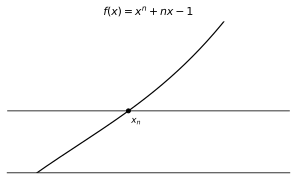

> 图像特征：$x<0$ 时 $f(x)<0$ 且无零点；$f(0)=-1<0$，$f(1)=n>0$，曲线在 $(0,1)$ 内单调上升并与 $x$ 轴唯一相交。

### 📝 例题 7

**【题目】**：证明方程 $x^n+x^{n-1}+\cdots+x=1$（$n$ 为大于 1 的整数）在区间 $\left(\dfrac12,1\right)$ 有且仅有一个实根。

**【解析】**：

证明：设 $f(x)=x^n+x^{n-1}+\cdots+x-1$ 在 $\left[\dfrac12,1\right]$ 连续，且

$$f\!\left(\frac12\right)=\frac{1}{2^n}+\frac{1}{2^{n-1}}+\cdots+\frac12-1=\frac{\frac12\left(1-\frac{1}{2^n}\right)}{1-\frac12}-1=-\frac{1}{2^n}<0$$

$$f(1)=1+1+\cdots+1-1=n-1>0$$

由零点定理，至少存在 $x_n\in\left(\dfrac12,1\right)$ 使得

$$f(x_n)=x_n^n+x_n^{n-1}+\cdots+x_n-1=0$$

又由于 $f'(x)=nx^{n-1}+(n-1)x^{n-2}+\cdots+1>0$，则 $f(x)$ 单调增，

故 $x_n\in\left(\dfrac12,1\right)$ 是方程的唯一实根。

### 📝 例题 8　★

**【题目】**：设 $f(x)$ 在 $[a,b]$ 上连续，且 $a<c<d<b$，证明在 $(a,b)$ 内至少存在一点 $\xi$，使得

$$pf(c)+qf(d)=(p+q)f(\xi)$$

其中 $p,q$ 为任意正数。

> 💡 **[旁注]**（蓝字，位于题目下方，标"加权平均"）：
> $$f(\xi)=\frac{pf(c)+qf(d)}{p+q}=\frac{p}{p+q}f(c)+\frac{q}{p+q}f(d)$$

**【解析】**：

证明：$f(x)$ 在 $[c,d]$ 连续，由最值定理，存在最大值 $M$、最小值 $m$，则

$$m\leq\frac{pf(c)+qf(d)}{p+q}\leq M$$

即

$$(p+q)m\leq pf(c)+qf(d)\leq(p+q)M$$

又由介值定理，存在 $\xi\in[c,d]\subset(a,b)$，使得

$$f(\xi)=\frac{pf(c)+qf(d)}{p+q}$$

---
